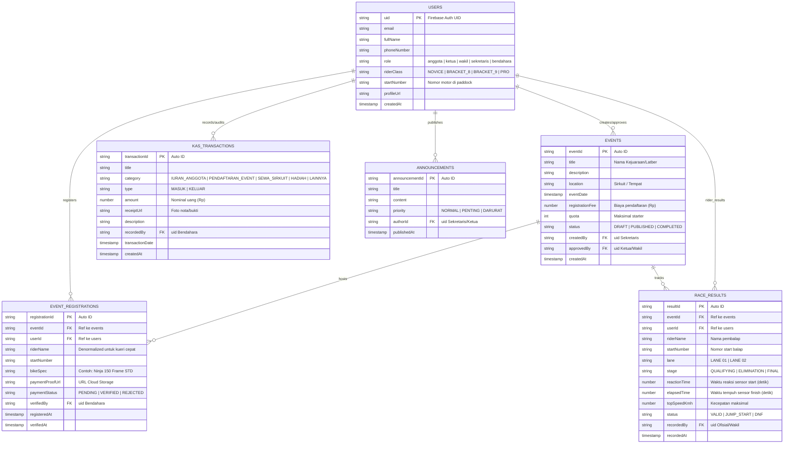

# Entity Relationship Diagram (ERD) & Skema Firestore
## DragHub: Arsitektur Data Komunitas Balap Drag Resmi
**Versi:** 1.0  
**Basis Data:** Google Cloud Firestore (Document NoSQL)  
**Dokumen Terkait:** [PRD_DragHub.md](PRD_DragHub.md) | [Pembagian_Tugas_GitFlow.md](Pembagian_Tugas_GitFlow.md)

---

## 1. Diagram Relasi Entitas (ERD Visual)



---

## 2. Rincian Koleksi Cloud Firestore

### 2.1 Koleksi: `users`
* **Path:** `/users/{uid}`
* **Kunci Dokumen:** `FirebaseAuth.currentUser.uid`

| Field | Tipe Data | Wajib | Keterangan |
| :--- | :--- | :---: | :--- |
| `uid` | String | Ya | ID unik dari Firebase Authentication |
| `email` | String | Ya | Email login |
| `fullName` | String | Ya | Nama lengkap pembalap / pengurus |
| `phoneNumber` | String | Ya | Nomor WhatsApp aktif |
| `role` | String | Ya | `'anggota'`, `'ketua'`, `'wakil'`, `'sekretaris'`, `'bendahara'` |
| `riderClass` | String | Ya | Default: `'NOVICE'` |
| `startNumber` | String | Tidak | Nomor start tetap motor (contoh: `'089'`) |
| `profileUrl` | String | Tidak | URL foto profil dari Cloud Storage |
| `createdAt` | Timestamp | Ya | `FieldValue.serverTimestamp()` |

---

### 2.2 Koleksi: `events`
* **Path:** `/events/{eventId}`

| Field | Tipe Data | Wajib | Keterangan |
| :--- | :--- | :---: | :--- |
| `eventId` | String | Ya | ID unik dokumen Firestore |
| `title` | String | Ya | Nama kejuaraan (contoh: *IDW Round 3 2026*) |
| `description` | String | Ya | Regulasi teknis dan rundown jadwal |
| `location` | String | Ya | Sirkuit (contoh: *NP Gelora Bung Tomo*) |
| `eventDate` | Timestamp | Ya | Tanggal dan jam pelaksanaan event |
| `registrationFee` | Number | Ya | Biaya pendaftaran per kelas motor (Rp) |
| `quota` | Integer | Ya | Batas maksimal pembalap per kelas |
| `status` | String | Ya | `'DRAFT'`, `'PUBLISHED'`, `'COMPLETED'` |
| `createdBy` | String | Ya | UID akun **Sekretaris** pembuat draft |
| `approvedBy` | String | Tidak | UID akun **Ketua / Wakil** yang mengesahkan |
| `createdAt` | Timestamp | Ya | Timestamp saat draft dibuat |

---

### 2.3 Koleksi: `event_registrations`
* **Path:** `/event_registrations/{registrationId}`

| Field | Tipe Data | Wajib | Keterangan |
| :--- | :--- | :---: | :--- |
| `registrationId`| String | Ya | ID pendaftaran unik |
| `eventId` | String | Ya | Foreign Key merujuk ke `/events/{eventId}` |
| `userId` | String | Ya | Foreign Key merujuk ke `/users/{uid}` |
| `riderName` | String | Ya | Nama pembalap untuk render UI cepat |
| `startNumber` | String | Ya | Nomor start motor yang didaftarkan |
| `bikeSpec` | String | Ya | Tipe motor (contoh: *Ninja 150 Frame STD*) |
| `paymentProofUrl` | String | Ya | URL gambar bukti transfer struk bank |
| `paymentStatus` | String | Ya | `'PENDING'`, `'VERIFIED'`, `'REJECTED'` |
| `verifiedBy` | String | Tidak | UID akun **Bendahara** yang memvalidasi |
| `registeredAt` | Timestamp | Ya | Waktu pendaftaran dilakukan |
| `verifiedAt` | Timestamp | Tidak | Waktu konfirmasi oleh bendahara |

---

### 2.4 Koleksi: `race_results` (Telemetri & Leaderboard)
* **Path:** `/race_results/{resultId}`

| Field | Tipe Data | Wajib | Keterangan |
| :--- | :--- | :---: | :--- |
| `resultId` | String | Ya | ID unik race timing |
| `eventId` | String | Ya | ID kejuaraan terkait |
| `userId` | String | Ya | UID pembalap |
| `riderName` | String | Ya | Nama pembalap pada papan klasemen |
| `startNumber` | String | Ya | Nomor motor start |
| `lane` | String | Ya | `'LANE 01'` atau `'LANE 02'` |
| `stage` | String | Ya | `'QUALIFYING'`, `'ELIMINATION'`, `'FINAL'` |
| `reactionTime` | Number | Ya | Waktu reaksi lampu hijau (detik) |
| `elapsedTime` | Number | Ya | **Waktu tempuh garis finish (detik)** |
| `topSpeedKmh` | Number | Tidak | Kecepatan tertinggi saat finish |
| `status` | String | Ya | `'VALID'`, `'JUMP_START'`, `'DNF'` |
| `recordedBy` | String | Ya | UID ofisial/wakil pencatat telemetri |
| `recordedAt` | Timestamp | Ya | Waktu pencatatan waktu |

---

### 2.5 Koleksi: `kas_transactions` (Keuangan Komunitas)
* **Path:** `/kas_transactions/{transactionId}`

| Field | Tipe Data | Wajib | Keterangan |
| :--- | :--- | :---: | :--- |
| `transactionId` | String | Ya | ID transaksi kas |
| `title` | String | Ya | Judul transaksi (contoh: *Iuran Kas Bulan November*) |
| `category` | String | Ya | `'IURAN_ANGGOTA'`, `'PENDAFTARAN_EVENT'`, `'SEWA_SIRKUIT'`, `'HADIAH'`, `'OPERASIONAL'` |
| `type` | String | Ya | `'MASUK'` atau `'KELUAR'` |
| `amount` | Number | Ya | Nominal transaksi dalam Rupiah (Rp) |
| `receiptUrl` | String | Tidak | Foto kuitansi / nota pengeluaran |
| `description` | String | Tidak | Catatan tambahan mutasi kas |
| `recordedBy` | String | Ya | UID akun **Bendahara** pencatat transaksi |
| `transactionDate`| Timestamp | Ya | Tanggal mutasi dilakukan |

---

## 3. Indeks Kueri Firestore (Compound Indexes)

Untuk mencegah error kueri majemuk di Flutter, indeks komposit berikut disiapkan:
1. **Leaderboard Tercepat:** `race_results` $\rightarrow$ `eventId` (ASC) + `status` (ASC) + `elapsedTime` (ASC)
2. **Riwayat Buku Kas:** `kas_transactions` $\rightarrow$ `type` (ASC) + `transactionDate` (DESC)
3. **Antrean Verifikasi Pendaftaran:** `event_registrations` $\rightarrow$ `eventId` (ASC) + `paymentStatus` (ASC) + `registeredAt` (ASC)

---

## 4. Firestore Security Rules (Validasi Hak Akses Server-Side)

```javascript
rules_version = '2';
service cloud.firestore {
  match /databases/{database}/documents {
    
    function isAuthenticated() {
      return request.auth != null;
    }

    function getUserRole() {
      return get(/databases/$(database)/documents/users/$(request.auth.uid)).data.role;
    }

    // Profil Pengguna
    match /users/{userId} {
      allow read: if isAuthenticated();
      allow create: if isAuthenticated();
      allow update: if isAuthenticated() && (request.auth.uid == userId || getUserRole() == 'ketua');
    }

    // Manajemen Event
    match /events/{eventId} {
      allow read: if isAuthenticated();
      allow create: if isAuthenticated() && getUserRole() in ['sekretaris', 'ketua'];
      allow update: if isAuthenticated() && getUserRole() in ['ketua', 'wakil', 'sekretaris'];
    }

    // Pendaftaran Event
    match /event_registrations/{regId} {
      allow read: if isAuthenticated();
      allow create: if isAuthenticated();
      allow update: if isAuthenticated() && getUserRole() in ['bendahara', 'ketua'];
    }

    // Hasil Telemetri & Leaderboard
    match /race_results/{resId} {
      allow read: if isAuthenticated();
      allow create, update: if isAuthenticated() && getUserRole() in ['wakil', 'sekretaris', 'ketua'];
    }

    // Kas Komunitas
    match /kas_transactions/{transId} {
      allow read: if isAuthenticated();
      allow create, update, delete: if isAuthenticated() && getUserRole() == 'bendahara';
    }
  }
}
```

