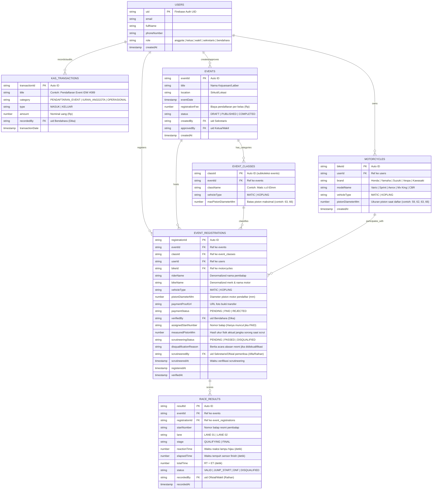

# Entity Relationship Diagram (ERD) & Skema Firestore
## DragHub: Arsitektur Data Komunitas Balap Drag Resmi
**Versi:** 1.2 (Scrutineering Verification & Disqualification Audit Schema)  
**Basis Data:** Google Cloud Firestore (Document NoSQL)  
**Dokumen Terkait:** [PRD_DragHub.md](PRD_DragHub.md) | [Pembagian_Tugas_GitFlow.md](Pembagian_Tugas_GitFlow.md)

---

## 1. Diagram Relasi Entitas (ERD Visual)



---

## 2. Rincian Koleksi Cloud Firestore

### 2.1 Koleksi: `motorcycles`
Menyimpan profil spesifikasi motor balap milik anggota komunitas.
* **Path:** `/users/{uid}/motorcycles/{bikeId}` atau `/motorcycles/{bikeId}`

| Field | Tipe Data | Wajib | Keterangan & Contoh Nilai |
| :--- | :--- | :---: | :--- |
| `bikeId` | String | Ya | ID dokumen unik |
| `userId` | String | Ya | Foreign Key merujuk ke `/users/{uid}` |
| `brand` | String | Ya | `'Honda'`, `'Yamaha'`, `'Suzuki'`, `'Vespa'`, `'Kawasaki'` |
| `modelName` | String | Ya | Contoh: `'Vario 125'`, `'Aerox 155'`, `'Mx King'`, `'Sprint 150'` |
| `vehicleType` | String | Ya | `'MATIC'` atau `'KOPLING'` |
| `pistonDiameterMm` | Number | Ya | Ukuran diameter piston dalam mm (contoh: `59`, `60`, `62`, `63`, `66`) |
| `createdAt` | Timestamp | Ya | `FieldValue.serverTimestamp()` |

---

### 2.2 Koleksi: `event_classes` (Subkoleksi Event)
Menentukan kelas balap resmi berdasarkan tipe motor dan batas maksimal diameter piston.
* **Path:** `/events/{eventId}/classes/{classId}`

| Field | Tipe Data | Wajib | Keterangan & Contoh Nilai |
| :--- | :--- | :---: | :--- |
| `classId` | String | Ya | ID unik kelas balap |
| `className` | String | Ya | Contoh: `'Matic s.d 63mm'`, `'Kopling s.d 66mm'` |
| `vehicleType` | String | Ya | `'MATIC'` atau `'KOPLING'` |
| `maxPistonDiameterMm` | Number | Ya | **Batas maksimal piston** (contoh: `63`, `66`). Piston motor tidak boleh melebihi batas ini. |

---

### 2.3 Koleksi: `event_registrations`
Pendaftaran kejuaraan yang menghubungkan pembalap, motor, status pembayaran, dan hasil verifikasi scrutineering.
* **Path:** `/event_registrations/{registrationId}`

| Field | Tipe Data | Wajib | Keterangan & Batasan |
| :--- | :--- | :---: | :--- |
| `registrationId`| String | Ya | ID registrasi unik |
| `eventId` | String | Ya | ID event kejuaraan balap |
| `classId` | String | Ya | ID kelas balap yang diikuti |
| `userId` | String | Ya | ID pembalap pendaftar |
| `bikeId` | String | Ya | ID motor yang digunakan balap |
| `vehicleType` | String | Ya | `'MATIC'` atau `'KOPLING'` |
| `pistonDiameterMm` | Number | Ya | Diameter piston motor pendaftar yang didaftarkan (mm) |
| `paymentProofUrl` | String | Ya | URL gambar foto struk transfer pendaftaran |
| `paymentStatus` | String | Ya | `'PENDING'`, `'PAID'`, `'REJECTED'` |
| `verifiedBy` | String | Tidak | **UID Bendahara (Dika)** yang memverifikasi struk bank |
| `assignedStartNumber`| String? | **Kondisional** | **Nomor Balap Resmi** (contoh: `'#089'`). **Hanya terbit jika `paymentStatus == 'PAID'`**. Null jika belum lunas. |
| `measuredPistonMm`| Number? | Tidak | **Hasil ukur aktual jangka sorong** di paddock saat scrutineering (contoh: `64.5`) |
| `scrutineeringStatus`| String | Ya | `'PENDING'`, `'PASSED'`, `'DISQUALIFIED'` |
| `disqualificationReason`| String? | Tidak | **Alasan Berita Acara Diskualifikasi** (contoh: *"Piston terukur 64.5mm overspec 1.5mm dari batas 63mm"*). Wajib diisi jika status = `'DISQUALIFIED'`. |
| `scrutineeredBy` | String? | Tidak | **UID Sekretaris / Ofisial (Alfa / Raihan)** pemeriksa fisik motor |
| `scrutineeredAt` | Timestamp? | Tidak | Waktu konfirmasi lolos atau diskualifikasi |
| `registeredAt` | Timestamp | Ya | Waktu pendaftaran |
| `verifiedAt` | Timestamp | Tidak | Waktu diverifikasi lunas oleh Bendahara |

---

### 2.4 Koleksi: `race_results` (Telemetri Sensor Balap)
* **Path:** `/race_results/{resultId}`

| Field | Tipe Data | Wajib | Keterangan |
| :--- | :--- | :---: | :--- |
| `resultId` | String | Ya | ID unik telemetri |
| `eventId` | String | Ya | ID kejuaraan |
| `registrationId`| String | Ya | ID registrasi peserta |
| `startNumber` | String | Ya | Nomor balap pembalap (diambil dari `assignedStartNumber`) |
| `lane` | String | Ya | `'LANE 01'` atau `'LANE 02'` |
| `stage` | String | Ya | `'QUALIFYING'` atau `'FINAL'` |
| `reactionTime` | Number | Ya | Waktu reaksi lampu start hijau (detik) |
| `elapsedTime` | Number | Ya | Waktu tempuh garis finish (detik) |
| `totalTime` | Number | Ya | Hasil `reactionTime + elapsedTime` |
| `status` | String | Ya | `'VALID'`, `'JUMP_START'`, `'DNF'`, `'DISQUALIFIED'` |
| `recordedBy` | String | Ya | UID ofisial pencatat waktu (Raihan/Wakil) |
| `recordedAt` | Timestamp | Ya | Waktu pencatatan sensor |

---

## 3. Logika Bisnis & Validasi Database (Business Logic)

### 3.1 Aturan Pembayaran & Penerbitan Nomor Balap:
* Ketika pendaftaran dibuat oleh pembalap:
  ```json
  {
    "paymentStatus": "PENDING",
    "assignedStartNumber": null,
    "scrutineeringStatus": "PENDING"
  }
  ```
* Ketika **Bendahara (Dika)** menekan tombol "Verifikasi Lunas":
  ```json
  {
    "paymentStatus": "PAID",
    "verifiedBy": "uid_bendahara",
    "verifiedAt": "2026-11-09T...",
    "assignedStartNumber": "#089"
  }
  ```

### 3.2 Aturan Validasi Scrutineering & Diskualifikasi:
* Input: `measuredPistonMm` hasil pengukuran fisik oleh Sekretaris (Alfa).
* Evaluasi:
  * Jika `measuredPistonMm <= class.maxPistonDiameterMm`:
    ```json
    {
      "scrutineeringStatus": "PASSED",
      "scrutineeredBy": "uid_sekretaris",
      "scrutineeredAt": "2026-11-09T..."
    }
    ```
  * Jika `measuredPistonMm > class.maxPistonDiameterMm` (Melebihi batas):
    Muncul dialog konfirmasi ganda $\rightarrow$ Petugas mengisi alasan $\rightarrow$ Firestore update:
    ```json
    {
      "scrutineeringStatus": "DISQUALIFIED",
      "disqualificationReason": "Piston terukur 64.5mm (Melebihi batas kelas 63.0mm)",
      "scrutineeredBy": "uid_sekretaris",
      "scrutineeredAt": "2026-11-09T..."
    }
    ```
