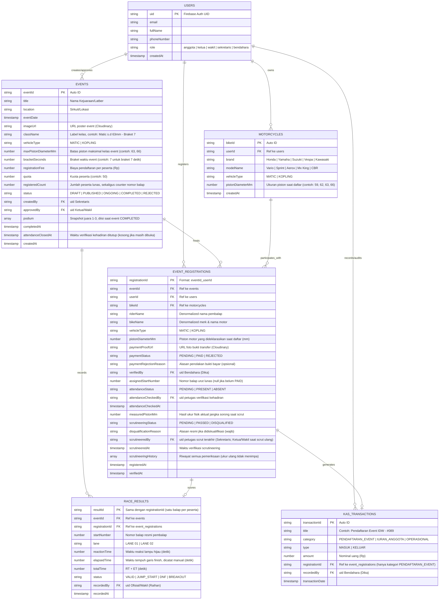

# Entity Relationship Diagram (ERD) & Skema Firestore
## DragHub: Arsitektur Data Komunitas Balap Drag Resmi
**Versi:** 1.3.1 (Kuota Peserta, Nomor Balap Urut Lunas, Scrutineering Sebelum Balap & Podium; Revisi Konsistensi dengan PRD dan GitFlow)  
**Basis Data:** Google Cloud Firestore (Document NoSQL)  
**Dokumen Terkait:** [PRD_DragHub.md](PRD_DragHub.md) | [Pembagian_Tugas_GitFlow.md](Pembagian_Tugas_GitFlow.md)

---

## 0. Ringkasan Perubahan dari v1.2

* **Satu event = satu kelas.** Koleksi `event_classes` dihapus. Kelas ditentukan oleh `vehicleType` + `maxPistonDiameterMm` langsung di dokumen `events`. Field `classId` dihapus dari `event_registrations`.
* **Kuota peserta.** `events` memiliki `quota` dan `registeredCount`. Sisa kuota = `quota - registeredCount`.
* **Nomor balap urut lunas.** Nomor terbit saat Bendahara memverifikasi `PAID`, berurutan mulai `1` (ditampilkan `#001`). Tanpa nomor sakral. Peserta yang tidak hadir dicoret, nomor lain tidak bergeser.
* **Kehadiran.** Field `attendanceStatus` ditambahkan di `event_registrations`.
* **Scrutineering dilakukan sebelum balap** (setelah peserta hadir). Diskualifikasi wajib disertai alasan.
* **Leaderboard realtime diganti podium juara 1 sampai 3**, hanya tampil setelah event berstatus `COMPLETED`.
* **Kecocokan motor dan event:** motor hanya bisa dipakai mendaftar jika `vehicleType` sama dan `pistonDiameterMm <= maxPistonDiameterMm` event.
* **Status event `ONGOING`** ditambahkan. Tombol "Mulai Event" menutup pendaftaran dan baru mengaktifkan kehadiran, scrutineering, dan telemetri.
* **Poster event:** field `imageUrl` ditambahkan di `events`.
* **Gambar disimpan di Cloudinary** (bukan Firebase Storage), karena proyek memakai plan Spark. Field `paymentProofUrl` dan `imageUrl` berisi URL Cloudinary.
* **Scrut ulang (keberatan rider):** rider yang merasa salah ukur bisa meminta pengukuran ulang oleh Ketua/Wakil. Semua pemeriksaan dicatat di `scrutineeringHistory`, tidak ada yang tertimpa.
* **Braket waktu:** field `bracketSeconds` ditambahkan di `events` (contoh: `7` untuk Braket 7 detik). Braket ditetapkan per event, jadi satu event tetap satu kelas dan satu podium.
* **Gugur karena braket:** hasil balap yang lebih cepat dari braket event (contoh 6,9 detik di Braket 7) otomatis berstatus `BREAKOUT` dan peserta gugur dari podium.
* **Satu kali balap per peserta:** field `stage` (kualifikasi/final) dihapus dari `race_results`, dan `resultId` disamakan dengan `registrationId`.
* **Tambahan kecil:** rincian koleksi `users`, `events`, `kas_transactions`; relasi kas ke registrasi; alasan penolakan pembayaran; status event `REJECTED`.

* **Revisi v1.3.1 (sinkronisasi dengan PRD v1.3.1 dan GitFlow v1.3):**
  * Wording "sensor" dihapus dari `race_results`: waktu dicatat manual oleh Ofisial.
  * Status `DISQUALIFIED` dihapus dari `race_results` (menghindari tertukar dengan DQ scrutineering). `JUMP_START` dan `DNF` dipertahankan dan dijelaskan.
  * Field `events.attendanceClosedAt` ditambahkan untuk aksi "Tutup Verifikasi Kehadiran".
  * Transaksi verifikasi lunas kini mengecek `events.status == PUBLISHED`. Alur penolakan dan unggah ulang bukti bayar dijelaskan.
  * Field podium `bestTime` diganti `totalTime`. Komentar `scrutineeredBy` disesuaikan dengan scrut ulang.
  * Keputusan koreksi hasil waktu dipindah dari "belum diputuskan" ke bagian 5.

---

## 1. Diagram Relasi Entitas (ERD Visual)



---

## 2. Rincian Koleksi Cloud Firestore

### 2.1 Koleksi: `users`
Profil anggota komunitas, terhubung ke Firebase Auth.
* **Path:** `/users/{uid}`

| Field | Tipe Data | Wajib | Keterangan & Contoh Nilai |
| :--- | :--- | :---: | :--- |
| `uid` | String | Ya | Firebase Auth UID (ID dokumen) |
| `email` | String | Ya | Email akun |
| `fullName` | String | Ya | Nama lengkap |
| `phoneNumber` | String | Ya | Nomor telepon |
| `role` | String | Ya | `'anggota'`, `'ketua'`, `'wakil'`, `'sekretaris'`, `'bendahara'`. Default `'anggota'` saat registrasi. |
| `createdAt` | Timestamp | Ya | `FieldValue.serverTimestamp()` |

---

### 2.2 Koleksi: `motorcycles`
Menyimpan profil spesifikasi motor balap milik anggota komunitas.
* **Path:** `/motorcycles/{bikeId}` (field `userId` menunjuk pemilik; satu pemilik boleh punya beberapa motor)

| Field | Tipe Data | Wajib | Keterangan & Contoh Nilai |
| :--- | :--- | :---: | :--- |
| `bikeId` | String | Ya | ID dokumen unik |
| `userId` | String | Ya | Foreign Key merujuk ke `/users/{uid}` |
| `brand` | String | Ya | `'Honda'`, `'Yamaha'`, `'Suzuki'`, `'Vespa'`, `'Kawasaki'` |
| `modelName` | String | Ya | Contoh: `'Vario 125'`, `'Aerox 155'`, `'Mx King'`, `'Sprint 150'` |
| `vehicleType` | String | Ya | `'MATIC'` atau `'KOPLING'` |
| `pistonDiameterMm` | Number | Ya | Ukuran diameter piston dalam mm (contoh: `59`, `60`, `62`, `63`, `66`) |
| `createdAt` | Timestamp | Ya | `FieldValue.serverTimestamp()` |

Motor tidak memerlukan persetujuan pengurus. Kebenaran spesifikasi dibuktikan saat scrutineering.

---

### 2.3 Koleksi: `events`
Kejuaraan atau latber balap. **Satu event hanya berisi satu kelas.**
* **Path:** `/events/{eventId}`

| Field | Tipe Data | Wajib | Keterangan & Contoh Nilai |
| :--- | :--- | :---: | :--- |
| `eventId` | String | Ya | ID dokumen unik |
| `title` | String | Ya | Nama event |
| `location` | String | Ya | Sirkuit/lokasi |
| `eventDate` | Timestamp | Ya | Tanggal pelaksanaan |
| `imageUrl` | String | Ya | URL poster event di Cloudinary |
| `className` | String | Ya | Label kelas untuk tampilan, contoh: `'Matic s.d 63mm - Braket 7'` |
| `vehicleType` | String | Ya | `'MATIC'` atau `'KOPLING'` |
| `maxPistonDiameterMm` | Number | Ya | **Batas maksimal piston** (contoh: `63`, `66`). Piston motor tidak boleh melebihi batas ini. |
| `bracketSeconds` | Number | Ya | **Braket waktu** event (contoh: `7` berarti Braket 7 detik). Semua peserta event berada di braket yang sama. |
| `registrationFee` | Number | Ya | Biaya pendaftaran per peserta (Rp) |
| `quota` | Number | Ya | Kuota peserta (contoh: `50`) |
| `registeredCount` | Number | Ya | Jumlah peserta yang sudah **lunas**. Awal `0`. Naik hanya di dalam transaction verifikasi lunas (lihat 3.2). Sekaligus menjadi counter nomor balap. |
| `status` | String | Ya | `'DRAFT'`, `'PUBLISHED'`, `'ONGOING'`, `'COMPLETED'`, `'REJECTED'` (alur di 3.7) |
| `createdBy` | String | Ya | UID Sekretaris pembuat draft |
| `approvedBy` | String | Tidak | UID Ketua/Wakil yang menyetujui |
| `podium` | Array? | Tidak | Snapshot juara 1 sampai 3, diisi saat status berubah ke `COMPLETED` (lihat 3.6) |
| `completedAt` | Timestamp? | Tidak | Waktu event dinyatakan selesai |
| `attendanceClosedAt` | Timestamp? | Tidak | Waktu verifikasi kehadiran ditutup lewat tombol "Tutup Verifikasi Kehadiran". Kosong selama kehadiran masih dibuka. |
| `createdAt` | Timestamp | Ya | `FieldValue.serverTimestamp()` |

**Sisa kuota** ditampilkan di kartu event untuk semua role: `quota - registeredCount`. Cukup membaca satu dokumen event, tidak perlu menghitung dokumen registrasi.

---

### 2.4 Koleksi: `event_registrations`
Pendaftaran peserta yang menghubungkan pembalap, motor, pembayaran, kehadiran, dan hasil scrutineering.
* **Path:** `/event_registrations/{eventId}_{userId}` (ID gabungan mencegah satu rider mendaftar dua kali di event yang sama)

| Field | Tipe Data | Wajib | Keterangan & Batasan |
| :--- | :--- | :---: | :--- |
| `registrationId`| String | Ya | `{eventId}_{userId}` |
| `eventId` | String | Ya | ID event |
| `userId` | String | Ya | ID pembalap pendaftar |
| `bikeId` | String | Ya | ID motor yang dipakai. Wajib memenuhi aturan kecocokan (3.1). |
| `riderName` | String | Ya | Denormalized nama pembalap |
| `bikeName` | String | Ya | Denormalized merk & nama motor |
| `vehicleType` | String | Ya | Snapshot jenis motor saat daftar |
| `pistonDiameterMm` | Number | Ya | Snapshot piston yang dideklarasikan saat daftar (mm) |
| `paymentProofUrl` | String | Ya | URL foto struk transfer di Cloudinary |
| `paymentStatus` | String | Ya | `'PENDING'`, `'PAID'`, `'REJECTED'` |
| `paymentRejectionReason` | String? | Tidak | Alasan bila bukti bayar ditolak |
| `verifiedBy` | String? | Tidak | UID Bendahara yang memverifikasi |
| `assignedStartNumber`| Number? | **Kondisional** | **Nomor balap**, urut berdasarkan waktu verifikasi lunas (`1`, `2`, ...; tampil `#001`). Null sebelum `PAID`. Tidak dipakai ulang dan tidak bergeser. |
| `attendanceStatus` | String | Ya | `'PENDING'`, `'PRESENT'` (hadir), `'ABSENT'` (dicoret). Awal `'PENDING'`. |
| `attendanceCheckedBy` | String? | Tidak | UID petugas yang memverifikasi kehadiran |
| `attendanceCheckedAt` | Timestamp? | Tidak | Waktu kehadiran diverifikasi |
| `measuredPistonMm`| Number? | Tidak | **Hasil ukur aktual jangka sorong** saat scrutineering (contoh: `64.5`) |
| `scrutineeringStatus`| String | Ya | `'PENDING'`, `'PASSED'`, `'DISQUALIFIED'` |
| `disqualificationReason`| String? | Tidak | **Alasan resmi diskualifikasi**, wajib jika status `'DISQUALIFIED'` (contoh: *"Piston terukur 66mm, ketentuan event maksimal 63mm"*). Menjadi bahan laporan. |
| `scrutineeredBy` | String? | Tidak | UID petugas scrut terakhir (Sekretaris, atau Ketua/Wakil saat scrut ulang) |
| `scrutineeredAt` | Timestamp? | Tidak | Waktu keputusan lolos atau diskualifikasi (hasil pemeriksaan terbaru) |
| `scrutineeringHistory` | Array | Tidak | Riwayat seluruh pemeriksaan, termasuk yang pertama. Tiap entri: `{ measuredPistonMm, status, reason, by, at }`. Field `measuredPistonMm`, `scrutineeringStatus`, `disqualificationReason`, `scrutineeredBy`, `scrutineeredAt` di atas selalu mencerminkan entri terakhir. |
| `registeredAt` | Timestamp | Ya | Waktu pendaftaran |
| `verifiedAt` | Timestamp? | Tidak | Waktu diverifikasi lunas |

---

### 2.5 Koleksi: `race_results` (Telemetri / Pencatatan Waktu Balap)
* **Path:** `/race_results/{resultId}`

| Field | Tipe Data | Wajib | Keterangan |
| :--- | :--- | :---: | :--- |
| `resultId` | String | Ya | Sama dengan `registrationId`: satu peserta hanya satu kali balap, jadi satu dokumen hasil per peserta |
| `eventId` | String | Ya | ID event |
| `registrationId`| String | Ya | ID registrasi peserta |
| `startNumber` | Number | Ya | Nomor balap (diambil dari `assignedStartNumber`) |
| `lane` | String | Ya | `'LANE 01'` atau `'LANE 02'` |
| `reactionTime` | Number | Ya | Waktu reaksi lampu start hijau (detik) |
| `elapsedTime` | Number | Ya | Waktu tempuh garis finish (detik) |
| `totalTime` | Number | Ya | Hasil `reactionTime + elapsedTime` |
| `status` | String | Ya | `'VALID'`, `'JUMP_START'` (start sebelum lampu hijau, ditandai Ofisial), `'DNF'` (tidak menyelesaikan lintasan, ditandai Ofisial), `'BREAKOUT'` (`totalTime` lebih cepat dari `events.bracketSeconds`, diisi otomatis oleh aplikasi) |
| `recordedBy` | String | Ya | UID ofisial pencatat waktu (Raihan/Wakil) |
| `recordedAt` | Timestamp | Ya | Waktu pencatatan hasil |

---

### 2.6 Koleksi: `kas_transactions`
Catatan mutasi kas komunitas.
* **Path:** `/kas_transactions/{transactionId}`

| Field | Tipe Data | Wajib | Keterangan |
| :--- | :--- | :---: | :--- |
| `transactionId` | String | Ya | ID dokumen unik |
| `title` | String | Ya | Contoh: `'Pendaftaran Event IDW - #089'` |
| `category` | String | Ya | `'PENDAFTARAN_EVENT'`, `'IURAN_ANGGOTA'`, `'OPERASIONAL'` |
| `type` | String | Ya | `'MASUK'` atau `'KELUAR'` |
| `amount` | Number | Ya | Nominal (Rp) |
| `registrationId` | String? | Tidak | Terisi otomatis untuk kategori `PENDAFTARAN_EVENT` |
| `recordedBy` | String | Ya | UID Bendahara |
| `transactionDate` | Timestamp | Ya | Tanggal transaksi |

---

## 3. Logika Bisnis & Validasi Database (Business Logic)

### 3.1 Aturan Pendaftaran & Kecocokan Motor
* Event harus berstatus `PUBLISHED` (belum `ONGOING`) dan `registeredCount < quota` agar tombol "Daftar" aktif. Tidak ada field batas waktu pendaftaran: pendaftaran tertutup saat event dimulai.
* Rider memilih salah satu motornya. Hanya motor yang memenuhi aturan berikut yang ditampilkan:
  * `motor.vehicleType == event.vehicleType`
  * `motor.pistonDiameterMm <= event.maxPistonDiameterMm` (contoh: piston 59 boleh ikut event Matic 63)
* Dokumen dibuat dengan ID `{eventId}_{userId}`. Jika sudah ada, pendaftaran ditolak.
* Keadaan awal:
  ```json
  {
    "paymentStatus": "PENDING",
    "assignedStartNumber": null,
    "attendanceStatus": "PENDING",
    "scrutineeringStatus": "PENDING"
  }
  ```
* Spesifikasi yang dideklarasikan tidak diblokir lebih jauh. Kebohongan spek ditangkap saat scrutineering.

### 3.2 Verifikasi Lunas, Nomor Balap, dan Kuota
Saat **Bendahara (Dika)** menekan "Verifikasi Lunas", seluruh langkah berikut dijalankan dalam **satu Firestore transaction**:
1. Baca dokumen event dan dokumen registrasi.
2. Jika `events.status` bukan `PUBLISHED`, tolak (pendaftaran dan verifikasi sudah tertutup).
3. Jika `paymentStatus` sudah `PAID`, hentikan (mencegah dobel).
4. Jika `registeredCount >= quota`, tolak dengan pesan "Kuota penuh".
5. `newNumber = registeredCount + 1`.
6. Perbarui `events.registeredCount = newNumber`.
7. Perbarui registrasi:
   ```json
   {
     "paymentStatus": "PAID",
     "verifiedBy": "uid_bendahara",
     "verifiedAt": "2026-11-09T...",
     "assignedStartNumber": 89
   }
   ```
8. Buat dokumen `kas_transactions` (`type: MASUK`, `category: PENDAFTARAN_EVENT`, `registrationId` terisi).

Jika bukti ditolak: `paymentStatus: "REJECTED"` dan `paymentRejectionReason` diisi (alasan wajib). Penolakan juga hanya dapat dilakukan saat event `PUBLISHED`. Saat rider mengunggah ulang, `paymentProofUrl` diganti URL baru, `paymentStatus` kembali `PENDING`, dan `paymentRejectionReason` dikosongkan.
Pendaftaran yang masih `PENDING` atau `REJECTED` saat event berubah ke `ONGOING` tidak dapat diverifikasi lagi, tidak mendapat nomor balap, dan tidak ikut balapan.

### 3.3 Verifikasi Kehadiran (Hari Event)
* Hanya aktif jika `events.status == "ONGOING"` dan `events.attendanceClosedAt` masih kosong.
* Rider membuka QR di aplikasinya (tersedia setelah `PAID`). Isi QR adalah `registrationId`, tidak ada field baru di database.
* Petugas (usulan: Sekretaris) memindai QR. Jika registrasi `PAID` dan `attendanceStatus == "PENDING"`, status menjadi `PRESENT` beserta `attendanceCheckedBy` dan `attendanceCheckedAt`.
* Jika sudah `PRESENT`, pemindaian kedua ditolak dengan pesan "sudah hadir", sehingga screenshot QR tidak bisa dipakai ulang.
* Petugas menekan **Tutup Verifikasi Kehadiran** (usulan: Sekretaris; Ketua/Wakil juga boleh). Dalam satu batch write, `events.attendanceClosedAt` diisi dan semua registrasi `PAID` yang masih `PENDING` diubah menjadi `ABSENT` (dicoret). Setelah itu pemindaian QR ditolak.
* Nomor yang dicoret **tidak dipakai ulang** dan nomor lain **tidak bergeser**. Contoh: #002 tidak hadir, #003 tetap #003.

### 3.4 Aturan Validasi Scrutineering & Diskualifikasi (Sebelum Balap)
* Syarat: `events.status == "ONGOING"`, `paymentStatus == "PAID"`, dan `attendanceStatus == "PRESENT"`.
* Input: `measuredPistonMm` hasil pengukuran fisik oleh Sekretaris (Alfa).
* Evaluasi:
  * Jika `measuredPistonMm <= event.maxPistonDiameterMm`:
    ```json
    {
      "measuredPistonMm": 62.9,
      "scrutineeringStatus": "PASSED",
      "scrutineeredBy": "uid_sekretaris",
      "scrutineeredAt": "2026-11-12T..."
    }
    ```
  * Jika `measuredPistonMm > event.maxPistonDiameterMm`: dialog konfirmasi muncul, petugas **wajib mengisi alasan**, lalu Firestore diperbarui:
    ```json
    {
      "measuredPistonMm": 66,
      "scrutineeringStatus": "DISQUALIFIED",
      "disqualificationReason": "Piston terukur 66mm, ketentuan event maksimal 63mm",
      "scrutineeredBy": "uid_sekretaris",
      "scrutineeredAt": "2026-11-12T..."
    }
    ```
* **Tanpa toleransi ukur:** selisih sekecil apa pun di atas batas (contoh: 63.02 mm untuk batas 63 mm) tetap `DISQUALIFIED`. Pengaman satu-satunya adalah scrut ulang.
* Alasan diskualifikasi wajib ada karena menjadi dasar laporan event dan bukti bila terjadi keberatan.

#### Scrut Ulang (Keberatan Rider)
* Jika rider merasa panitia salah ukur, ia datang langsung ke Ketua atau Wakil. Aplikasi tidak memiliki fitur pengajuan keberatan.
* **Ketua atau Wakil** (bukan petugas yang mengukur pertama) membuka layar scrut yang sama dan memasukkan ukuran baru. Syarat: `events.status == "ONGOING"`.
* Setiap pemeriksaan ditambahkan ke `scrutineeringHistory`, lalu field hasil terbaru diperbarui:
  ```json
  {
    "measuredPistonMm": 62.8,
    "scrutineeringStatus": "PASSED",
    "disqualificationReason": null,
    "scrutineeredBy": "uid_ketua",
    "scrutineeredAt": "2026-11-12T...",
    "scrutineeringHistory": [
      { "measuredPistonMm": 66, "status": "DISQUALIFIED", "reason": "Piston terukur 66mm, ketentuan event maksimal 63mm", "by": "uid_sekretaris", "at": "2026-11-12T..." },
      { "measuredPistonMm": 62.8, "status": "PASSED", "reason": null, "by": "uid_ketua", "at": "2026-11-12T..." }
    ]
  }
  ```
* Jika hasil ulang `PASSED`, rider kembali boleh balap. Nomor balap dan kuota tidak berubah.
* Jika hasil ulang tetap `DISQUALIFIED`, alasan wajib diisi lagi.
* Catatan teknis: `at` di dalam array memakai `Timestamp.now()` dari client, karena `FieldValue.serverTimestamp()` tidak didukung di dalam array Firestore.

### 3.5 Pencatatan Telemetri
* Hanya aktif jika `events.status == "ONGOING"`. Hanya registrasi dengan `paymentStatus == "PAID"`, `attendanceStatus == "PRESENT"`, dan `scrutineeringStatus == "PASSED"` yang boleh dicatat di `race_results`.
* Saat hasil dicatat, jika `totalTime < events.bracketSeconds`, aplikasi otomatis memberi `status: "BREAKOUT"` dan petugas tidak bisa mengubahnya menjadi `VALID`. Contoh: event Braket 7, hasil 6,9 detik berarti `BREAKOUT`. Waktu lebih lambat dari braket (contoh 8,3 detik) tetap `VALID`.
* Setiap peserta hanya balap satu kali. Dokumen hasil dibuat dengan ID `registrationId`, sehingga tidak bisa ada dua hasil untuk satu peserta.
* Ofisial dapat menandai hasil sebagai `JUMP_START` atau `DNF`. Hasil berstatus ini tidak ikut peringkat podium.
* Hasil boleh ditimpa oleh Wakil atau Ketua selama `ONGOING` (tanpa riwayat koreksi) dan terkunci saat `COMPLETED`.

### 3.6 Podium (Setelah Balapan Selesai)
* Podium hanya tampil jika `events.status == "COMPLETED"`. Tidak ada klasemen realtime.
* Saat event diubah dari `ONGOING` ke `COMPLETED` ("Akhiri Event"), sistem menghitung: ambil `race_results` berstatus `VALID` (satu dokumen per peserta); urutkan `totalTime` menaik; ambil tiga teratas. Jika `totalTime` sama, `reactionTime` yang lebih kecil menang. Peserta dengan hasil `BREAKOUT` dinyatakan **gugur** dan tidak ikut peringkat.
* Braket ditetapkan per event (`bracketSeconds`), jadi semua peserta satu braket dan podiumnya tunggal. Tidak ada podium per braket.
* Hasilnya disimpan sebagai snapshot di `events.podium`:
  ```json
  [
    { "rank": 1, "registrationId": "evt1_uidA", "riderName": "...", "bikeName": "...", "startNumber": 12, "totalTime": 7.512 },
    { "rank": 2, "registrationId": "evt1_uidB", "riderName": "...", "bikeName": "...", "startNumber": 5, "totalTime": 7.604 },
    { "rank": 3, "registrationId": "evt1_uidC", "riderName": "...", "bikeName": "...", "startNumber": 31, "totalTime": 7.690 }
  ]
  ```
* Karena scrutineering sudah dilakukan sebelum balap, tidak ada pergeseran peringkat akibat diskualifikasi spek.

### 3.7 Siklus Status Event
```
DRAFT --(Ketua/Wakil setuju)--> PUBLISHED --(Mulai Event)--> ONGOING --(Akhiri Event)--> COMPLETED
  |
  +--(Ketua/Wakil tolak)--> REJECTED
```
* `PUBLISHED`: event tampil, pendaftaran dan verifikasi pembayaran berjalan.
* `ONGOING`: pendaftaran tertutup, kehadiran, scrutineering, dan telemetri aktif.
* `COMPLETED`: podium tampil, semua data hanya-baca.

---

### 3.8 Catatan Implementasi
* **Role:** pengurus (`ketua`, `wakil`, `sekretaris`, `bendahara`) diubah manual lewat Firebase Console. Nilai ditulis persis huruf kecil. Aplikasi selalu membuat akun baru dengan `role: 'anggota'`. Security Rules melarang client mengubah `role`.
* **Security Rules:** perubahan field scrut pada registrasi yang sudah `DISQUALIFIED` hanya boleh oleh Ketua/Wakil. Hak tulis tiap koleksi dibatasi per role dan per field (lihat matriks RBAC di PRD). Konsistensi antar dokumen (counter kuota, nomor balap) dijaga lewat transaction di aplikasi. Verifikasi dan penolakan bukti bayar hanya diizinkan saat event `PUBLISHED`, dan pemindaian QR ditolak setelah `attendanceClosedAt` terisi.
* **Plan Firebase:** Spark (tanpa Cloud Functions dan tanpa Firebase Storage). Gambar diunggah ke Cloudinary lewat *unsigned upload preset*, dan API secret tidak boleh ada di aplikasi.
* **QR kehadiran:** generate QR di sisi rider dengan `qr_flutter`, pindai di sisi petugas dengan `mobile_scanner`.
* **Kebijakan biaya:** biaya pendaftaran tidak dikembalikan jika peserta didiskualifikasi. Uangnya sudah tercatat sebagai kas `MASUK` sejak verifikasi lunas, dan diskualifikasi tidak membuat transaksi kas `KELUAR`, jadi tidak ada perubahan data.
* **Batasan Cloudinary:** gambar tidak bisa dihapus dari aplikasi; ganti bukti bayar berarti URL baru, file lama tetap ada. URL bersifat publik bagi yang punya link.

---

## 4. Hal yang Belum Diputuskan
1. Siapa petugas yang memindai QR kehadiran dan menekan "Tutup Verifikasi Kehadiran" (usulan: Sekretaris; Ketua atau Wakil juga boleh). "Mulai Event" dan "Akhiri Event" sudah diputuskan: Ketua atau Wakil.
2. Kebijakan biaya bila peserta dicoret karena tidak hadir (usulan: sama seperti diskualifikasi, tidak dikembalikan).

---

## 5. Sudah Diputuskan (Sebelumnya Terbuka)
* **Koreksi hasil telemetri:** boleh ditimpa oleh Wakil (Ofisial) atau Ketua selama event `ONGOING`, tanpa riwayat koreksi, dan terkunci saat `COMPLETED`. Pembanding braket memakai `totalTime` (RT + ET), sama dengan penentu podium.
