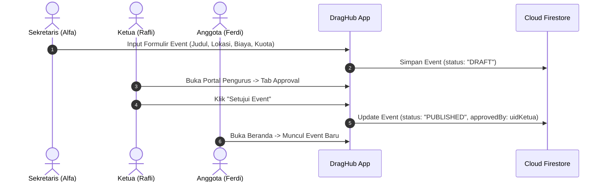
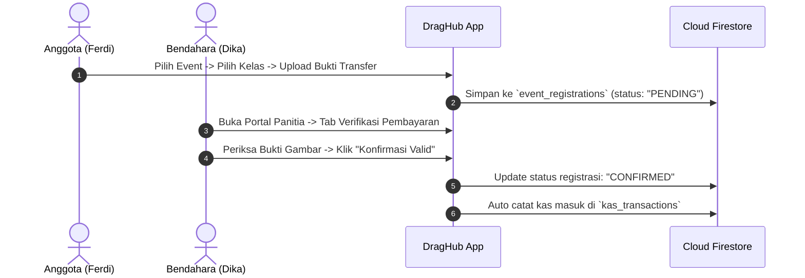
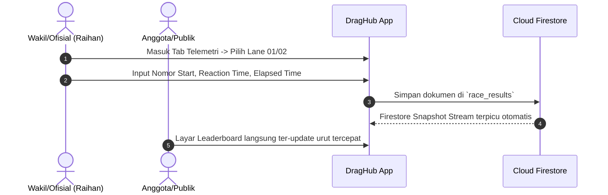

# Product Requirements Document (PRD)
## DragHub: Sistem Informasi Komunitas & Manajemen Balap Drag Resmi
**Versi:** 1.0  
**Tanggal:** 8 November 2026  
**Status:** Approved for Development  
**Platform:** Flutter Mobile (Android & iOS) + Google Firebase (Auth & Cloud Firestore)  
**Dokumen Terkait:** [ERD_DragHub.md](ERD_DragHub.md) | [Pembagian_Tugas_GitFlow.md](Pembagian_Tugas_GitFlow.md)

---

## 1. Latar Belakang & Tujuan Produk

### 1.1 Problem Statement
Komunitas balap motor drag resmi di Indonesia menghadapi kendala operasional yang masih konvensional (tersebar di WhatsApp dan catatan fisik):
1. **Pencatatan Keuangan Manual:** Iuran pendaftaran event balap dan kas komunitas rawan tidak transparan dan sulit direkap oleh bendahara.
2. **Verifikasi Starter Lambat:** Pengecekan bukti transfer pendaftaran, legalitas kelas motor, dan nomor start paddock memakan waktu saat *scrutineering*.
3. **Penyusunan Agenda & Persetujuan Event:** Pengajuan jadwal latihan bersama (latber) atau kejurda dari sekretaris sering tumpang tindih tanpa pengesahan resmi dari ketua organisasi.
4. **Telemetri Balap & Leaderboard Terpisah:** Catatan waktu sensor garis finish (*Reaction Time* & *Elapsed Time*) terlambat dipublikasikan ke pembalap.
5. **Permintaan Dosen Praktikum:** Sistem harus merefleksikan hierarki organisasi resmi komunitas: **Ketua**, **Wakil Ketua**, **Sekretaris**, **Bendahara**, dan **Anggota (Pembalap)**.

### 1.2 Tujuan Produk (Goals)
* **Arsitektur RBAC Modular:** Menerapkan sistem *Role-Based Access Control* di mana antarmuka pengguna tidak diduplikasi, melainkan hak akses menu dan tombol dinamis sesuai peran.
* **Manajemen Event Terstruktur:** Alur pengajuan agenda balap oleh Sekretaris dan pengesahan (approval) oleh Ketua/Wakil Ketua.
* **Transparansi Kas Komunitas:** Pencatatan kas masuk/keluar oleh Bendahara yang dapat diaudit oleh Ketua dan dipantau saldonya oleh seluruh anggota.
* **Telemetri Balap Realtime:** Input waktu balap per lintasan (*Lane 01 / Lane 02*) yang langsung memperbarui papan klasemen (*Leaderboard*).

---

## 2. Struktur Organisasi & Pemetaan Persona

Sistem membagi pengguna ke dalam 5 entitas peran resmi:

| Peran (Role) | Representasi Tim | Tanggung Jawab Utama dalam Aplikasi |
| :--- | :--- | :--- |
| **Ketua (President)** | **Rafli** *(Project Lead)* | • Pengawasan menyeluruh aktivitas komunitas • Menyetujui (*Approve*) atau Menolak (*Reject*) draft event resmi • Memantau laporan audit mutasi kas dari Bendahara |
| **Wakil Ketua** | **Raihan** | • Membantu tugas eksekutif Ketua • Otorisasi event cadangan jika Ketua berhalangan • Pengawasan teknis telemetri balap |
| **Sekretaris** | **Alfa** | • Menyusun agenda event balap resmi & latber (*Drafting Event*) • Mengelola pengumuman dan regulasi teknis balap • Merekap kuota dan verifikasi administrasi pembalap |
| **Bendahara** | **Dika** | • Mencatat mutasi kas masuk dan keluar (uang sirkuit, iuran, pendaftaran) • Memeriksa & memvalidasi bukti transfer pendaftaran event • Menerbitkan transparansi saldo kas komunitas |
| **Anggota (Pembalap/Rider)** | **Ferdi** | • Registrasi akun paddock dan melengkapi profil motor • Mendaftar event balap dan mengunggah foto struk transfer • Memantau klasemen catatan waktu di Leaderboard |

---

## 3. Matriks Hak Akses (Role-Based Access Control / RBAC)

| Fitur / Modul | Anggota (Rider) | Sekretaris | Bendahara | Ketua & Wakil |
| :--- | :---: | :---: | :---: | :---: |
| **Lihat Kalender Event & Leaderboard** | ✅ Read | ✅ Read | ✅ Read | ✅ Read |
| **Daftar Event & Upload Bukti Bayar** | ✅ Create | ✅ Create | ✅ Create | ✅ Create |
| **Buat / Edit Draft Event Balap** | ❌ | ✅ Create / Edit | ❌ | ✅ Full Access |
| **Approval / Otorisasi Event Tayang** | ❌ | ❌ | ❌ | ✅ Approve / Reject |
| **Input Data Telemetri (Waktu Balap)** | ❌ | ✅ Input (Ofisial) | ❌ | ✅ Full Access |
| **Input Mutasi Kas (Masuk / Keluar)** | ❌ | ❌ | ✅ Create / Edit | ❌ (Hanya Audit) |
| **Verifikasi Bukti Transfer Pendaftaran** | ❌ | ❌ | ✅ Approve / Reject | ✅ Monitoring |
| **Akses Portal Khusus Pengurus** | ❌ | ✅ Tab Event | ✅ Tab Pembayaran | ✅ Full Tabs |

---

## 4. Alur Bisnis Utama (Core User Journeys)

### 4.1 Alur Pengajuan & Pengesahan Event (Sekretaris $\rightarrow$ Ketua $\rightarrow$ Anggota)

### 4.2 Alur Pendaftaran & Verifikasi Pembayaran (Anggota $\rightarrow$ Bendahara)

### 4.3 Alur Input Telemetri & Leaderboard (Ofisial $\rightarrow$ Leaderboard Realtime)

---

## 5. Rincian Kebutuhan Fungsional (Functional Requirements)

### Modul 1: Autentikasi & Manajemen Akun
* **FR-1.1 Pendaftaran Akun Paddock:** Pengguna baru dapat mendaftar melalui `RegisterScreen` dengan nama lengkap, email, nomor WhatsApp, nomor start idaman, dan kelas pembalap (`NOVICE`, `BRACKET 8`, `BRACKET 9`, dll.). Akun baru otomatis memiliki role `anggota`.
* **FR-1.2 Multi-Role Login:** `LoginScreen` menyediakan autentikasi Firebase Auth dengan fitur *Role Detection*. Jika akun terdaftar memiliki role pengurus (`ketua`, `wakil`, `sekretaris`, `bendahara`), aplikasi mengarahkan ke `PanitiaHomeScreen`. Jika anggota biasa, diarahkan ke `HomeScreen`.
* **FR-1.3 Sesi & Logout:** Logout terproteksi dialog konfirmasi pada avatar profil di `HomeScreen` dan tombol logout di `PanitiaHomeScreen`.

### Modul 2: Modul Beranda & Registrasi Event Pembalap (Rider Portal)
* **FR-2.1 Tampilan Beranda Dinamis:** Menampilkan status pembalap, kategori mesin, kalender agenda kejuaraan balap, dan tab event *Aktif* vs *Mendatang*.
* **FR-2.2 Pendaftaran Balap:** Anggota dapat memilih kejuaraan berstatus `PUBLISHED`, memilih motor balap, dan melampirkan foto bukti pembayaran pendaftaran.

### Modul 3: Modul Pengurus Terintegrasi (Official Portal)
* **FR-3.1 Tab Pembayaran (Bendahara):** Menampilkan daftar pendaftar yang belum diverifikasi, modal dialog *preview* gambar bukti transfer, dan aksi setujui/tolak pembayaran.
* **FR-3.2 Tab Telemetri (Ofisial / Wakil Ketua):** Formulir cepat untuk memasukkan hasil sensor garis finish balap (nomor start, lane, stage eliminasi, reaction time, elapsed time).
* **FR-3.3 Tab Event & Regulasi (Sekretaris):** Formulir pembuatan kejuaraan baru, penetapan kuota peserta, lokasi sirkuit, dan biaya registrasi.

### Modul 4: Papan Klasemen (Leaderboard Screen)
* **FR-4.1 Realtime Ranking:** Menampilkan podium 3 besar (Gold, Silver, Bronze) dan tabel daftar pembalap dengan waktu tempuh tercepat (*Elapsed Time* terendah).
* **FR-4.2 Filter Kategori:** Filter klasemen berdasarkan kelas motor balap (Bebek 4T 200cc, Sport 2T 150cc Frame STD, Bracket 8 Detik, Bracket 9 Detik).

---

## 6. Kebutuhan Non-Fungsional (Non-Functional Requirements)
1. **Performa:** Render daftar list menggunakan `ListView.builder` dan `SingleChildScrollView` teroptimasi dengan memori stabil.
2. **Keandalan Jaringan:** Penanganan *offline cache* Cloud Firestore agar data terakhir tetap dapat terbaca saat koneksi di area sirkuit tidak stabil.
3. **Standar Kode:** Menggunakan Flutter 3.47+ dan Dart 3.13+, menerapkan pemisahan file modular (*Clean Architecture: Models, Services, Screens*).

