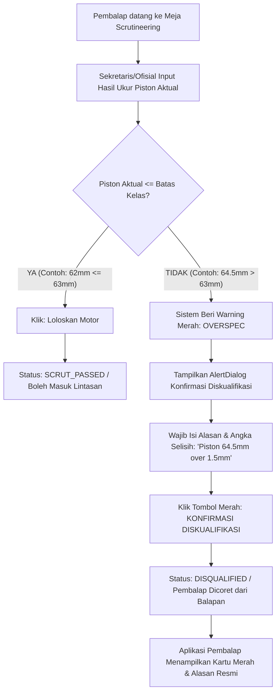
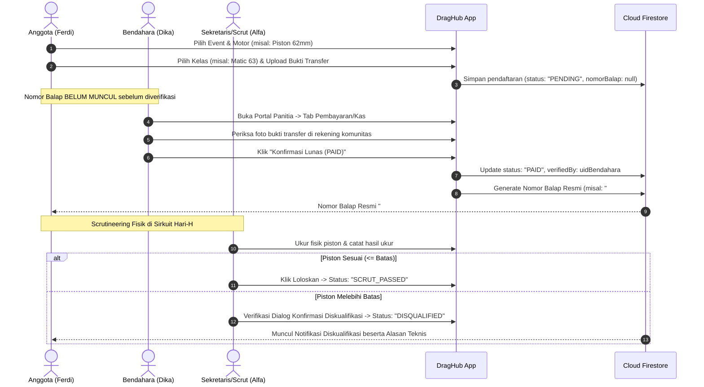

# Product Requirements Document (PRD)
## DragHub: Sistem Informasi Komunitas & Manajemen Balap Drag Resmi
**Versi:** 1.2 (Scrutineering Verification & Disqualification Protocol Update)  
**Tanggal:** 9 November 2026  
**Status:** Approved for Development  
**Platform:** Flutter Mobile (Android & iOS) + Google Firebase (Auth & Cloud Firestore)  
**Dokumen Terkait:** [ERD_DragHub.md](ERD_DragHub.md) | [Pembagian_Tugas_GitFlow.md](Pembagian_Tugas_GitFlow.md)

---

## 1. Latar Belakang & Tujuan Produk

### 1.1 Problem Statement
Komunitas balap motor drag resmi di Indonesia menghadapi kendala operasional yang masih konvensional (tersebar di WhatsApp dan catatan fisik):
1. **Regulasi Kelas Balap & Scrutineering:** Penentuan kelas motor drag resmi ditentukan secara ketat berdasarkan **Tipe Transmisi (Matic / Kopling)** dan **Ukuran Diameter Piston (mm)**. Pengukuran fisik (*scrutineering*) rawan manipulasi atau kesalahan teknis (*human error*) jika tidak tercatat dengan bukti kuat di sistem.
2. **Pencatatan Keuangan & Verifikasi Pembayaran:** Pengecekan bukti transfer pendaftaran harus berada di bawah wewenang resmi **Bendahara**.
3. **Penerbitan Nomor Balap yang Tertib:** Nomor start/balap tidak boleh diterbitkan sembarangan sebelum uang pendaftaran diverifikasi lunas oleh Bendahara.
4. **Prosedur Diskualifikasi Resmi:** Diskualifikasi pembalap karena overspec piston membutuhkan mekanisme **konfirmasi ganda (*double-confirmation*)** dan catatan berita acara digital agar terhindar dari salah klik (*misclick*) dan sengketa protes pembalap di paddock.
5. **Permintaan Dosen Praktikum:** Sistem harus merefleksikan hierarki organisasi resmi komunitas: **Ketua**, **Wakil Ketua**, **Sekretaris**, **Bendahara**, dan **Anggota (Pembalap)**.

### 1.2 Tujuan Produk (Goals)
* **Standardisasi Regulasi Piston:** Menerapkan validasi kelas balap berbasis batas diameter piston maksimal (contoh: *Matic 63*, *Kopling 66*). Piston $\le$ batas dinyatakan **Lolos Scrutineering**, sedangkan piston $>$ batas dinyatakan **Diskualifikasi (DQ)**.
* **Protokol Verifikasi Diskualifikasi (Anti-Misclick):** Mengharuskan petugas scrutineering memasukkan ukuran aktual terukur dan mengonfirmasi dialog peringatan bertingkat sebelum mendiskualifikasi pembalap.
* **Akuntabilitas Finansial & Auto-Start Number:** Verifikasi bukti transfer oleh Bendahara yang secara otomatis membuka/menerbitkan **Nomor Balap Resmi** bagi pembalap.
* **Manajemen Profil Kendaraan Spesifik:** Form pendataan motor pembalap mencakup Merk, Nama Kendaraan, Tipe Kendaraan (Matic/Kopling), dan Diameter Piston (mm).
* **Telemetri Balap & Leaderboard Realtime:** Input waktu balap per lintasan (*Lane 01 / Lane 02*) yang langsung memperbarui papan klasemen (*Leaderboard*).

---

## 2. Struktur Organisasi & Pembagian Kewenangan

| Peran (Role) | Personel Tim | Tanggung Jawab dalam Sistem |
| :--- | :--- | :--- |
| **Ketua (President)** | **Rafli** *(Project Lead)* | • Pengawasan menyeluruh aktivitas komunitas • Menyetujui (*Approve*) atau Menolak draft event resmi • Memantau laporan audit mutasi kas & log diskualifikasi peserta |
| **Wakil Ketua** | **Raihan** | • Membantu tugas eksekutif Ketua • Otorisasi event cadangan jika Ketua berhalangan • Pengawasan teknis telemetri balap & pendampingan meja scrutineering |
| **Sekretaris** | **Alfa** | • Menyusun agenda event balap & menentukan regulasi batas piston per kelas • **Petugas Utama Meja Scrutineering:** Menginput hasil ukur fisik piston motor pembalap di paddock • Melakukan verifikasi diskualifikasi peserta overspec dengan berita acara digital |
| **Bendahara** | **Dika** | • **Memeriksa & memverifikasi bukti transfer pendaftaran event** • Mengesahkan status pembayaran menjadi **LUNAS (PAID)** yang memicu terbitnya Nomor Balap pembalap • Mencatat kas masuk/keluar & transparansi saldo komunitas *(Bendahara TIDAK mengurusi teknis mesin)* |
| **Anggota (Pembalap/Rider)** | **Ferdi** | • Mendaftarkan profil motor (Merk, Nama Kendaraan, Tipe, Diameter Piston) • Mendaftar kelas event & upload struk bukti transfer • Menerima Nomor Balap resmi setelah diverifikasi Bendahara • Menerima status hasil scrutineering resmi (Lolos / Diskualifikasi beserta alasannya) |

---

## 3. Regulasi Kelas Balap & Protokol Scrutineering Piston

### 3.1 Aturan Penentuan Kelas (Piston-Based Classes)
Kelas balap pada DragHub ditentukan oleh **Tipe Kendaraan** dan **Batas Maksimal Diameter Piston**:
1. **Kelas Matic (Batas Piston Maksimal):**
   * Contoh: `MATIC_59` (Piston $\le$ 59 mm)
   * Contoh: `MATIC_63` (Piston $\le$ 63 mm)
2. **Kelas Kopling / Manual (Batas Piston Maksimal):**
   * Contoh: `KOPLING_62` (Piston $\le$ 62 mm)
   * Contoh: `KOPLING_66` (Piston $\le$ 66 mm)

### 3.2 Ketentuan Logika Scrutineering (Inspeksi Fisik)
* **Aturan Lolos:** Ukuran piston motor pembalap **HARUS $\le$ batas ketentuan kelas**.
  * *Contoh Lolos:* Motor Vario dengan piston **62 mm** mendaftar di kelas **Matic 63** $\rightarrow$ **VALID (Lolos)** karena ukuran piston tidak melebihi batas maksimal.
* **Aturan Diskualifikasi (DQ):** Jika ukuran piston motor **LEBIH BESAR ($>$) dari ketentuan kelas**, motor otomatis **DIDISKUALIFIKASI** dari kejuaraan.
  * *Contoh Diskualifikasi:* Motor Aerox dengan piston **64.5 mm** mendaftar di kelas **Matic 63** $\rightarrow$ **DISKUALIFIKASI (DQ)** karena melebihi batas 63 mm.

---

### 3.3 Protokol Dialog Konfirmasi & Verifikasi Diskualifikasi (Anti-Misclick)
Untuk menjamin keadilan dan mencegah kesalahan operasional saat pemeriksaan fisik di paddock:

#### Spesifikasi UI Dialog Konfirmasi Diskualifikasi:
1. **Header Dialog:** Peringatan Berwarna Merah Tegas (`Icons.warning_amber_rounded`) bertuliskan *"KONFIRMASI DISKUALIFIKASI PEMBALAP"*.
2. **Ringkasan Data Pembanding:**
   * Nama Pembalap & Nomor Balap: Misal `#089 • Ferdi Rider`
   * Batas Maksimal Kelas: **63.0 mm**
   * Ukuran Terukur Aktual: **64.5 mm** *(Overspec +1.5 mm)*
3. **Field Berita Acara / Alasan:**  
   Input teks wajib yang menjelaskan metode ukur (contoh: *"Pengukuran fisik menggunakan jangka sorong mitutoyo di paddock menyatakan piston 64.5 mm"*).
4. **Tombol Keputusan:**
   * Tombol Batal / Ukur Ulang.
   * Tombol Merah: **"Tetapkan Diskualifikasi"** (Mengubah status menjadi `DISQUALIFIED` dan mencatat UID pemeriksa).

---

## 4. Spesifikasi Form & Alur Bisnis Utama

### 4.1 Form Profil Motor Pembalap (Rider Vehicle Profile)
Saat anggota menambahkan data motor balapnya ke sistem, form wajib mengumpulkan data berikut:
1. **Merk Kendaraan:** Dropdown: `Honda`, `Yamaha`, `Suzuki`, `Kawasaki`, `Vespa`.
2. **Nama Kendaraan:** Input teks nama model (contoh: `Vario 125`, `Sprint 150`, `Aerox 155`, `Mx King`, `CBR 150R`, `Ninja 150`).
3. **Tipe Kendaraan:** Dropdown:
   * `Matic` (Transmisi Otomatis/CVT)
   * `Kopling` (Transmisi Manual Berkopling)
4. **Ukuran Diameter Piston (mm):** Input numerik ukuran piston mesin (contoh: `59`, `60`, `62`, `63`, `66` mm).

---

### 4.2 Alur Pendaftaran, Pembayaran & Penerbitan Nomor Balap
> **Siapa yang memverifikasi pembayaran?**  
> **BENDAHARA (Dika)** adalah satu-satunya ofisial yang berwenang memvalidasi bukti transfer uang pendaftaran.

---

## 5. Matriks Hak Akses (Role-Based Access Control / RBAC)

| Fitur / Modul | Anggota (Rider) | Sekretaris | Bendahara | Ketua & Wakil |
| :--- | :--- | :---: | :---: | :---: |
| **Input Profil Motor (Merk, Tipe, Piston)** | ✅ Create / Edit | ❌ | ❌ | ❌ |
| **Daftar Event Balap & Upload Bukti** | ✅ Create | ❌ | ❌ | ❌ |
| **Lihat Nomor Balap Resmi** | ✅ (Setelah Lunas) | ✅ Read | ✅ Read | ✅ Read |
| **Verifikasi Bukti Transfer Pendaftaran** | ❌ | ❌ | ✅ **Full Approve** | ✅ Monitoring |
| **Input Ukur Scrutineering & Loloskan** | ❌ | ✅ **Full Access**| ❌ | ✅ Full Access |
| **Verifikasi & Eksekusi Diskualifikasi Peserta** | ❌ | ✅ **Petugas Scrut**| ❌ | ✅ Full Access |
| **Buat / Edit Regulasi Event & Kelas** | ❌ | ✅ Create / Edit | ❌ | ✅ Full Access |
| **Approval Event Resmi Tayang** | ❌ | ❌ | ❌ | ✅ **Full Approve** |
| **Input Telemetri Waktu Balap** | ❌ | ✅ Ofisial Balap | ❌ | ✅ Full Access |

---

## 6. Kebutuhan Non-Fungsional
1. **Pencegahan Human Error:** Aksi diskualifikasi wajib melewati validasi konfirmasi ganda (*Confirmation Barrier*) untuk meminimalkan salah pencet.
2. **Auditabilitas Bukti Diskualifikasi:** Sistem menyimpan ID ofisial pemeriksa, waktu pemeriksaan, dan alasan detail dalam database Firestore.
3. **Penyampaian Transparan ke Pembalap:** Status diskualifikasi langsung tercermin pada halaman utama pembalap dengan rincian pengukuran aktual agar terbebas dari kecurigaan kecurangan panitia.
