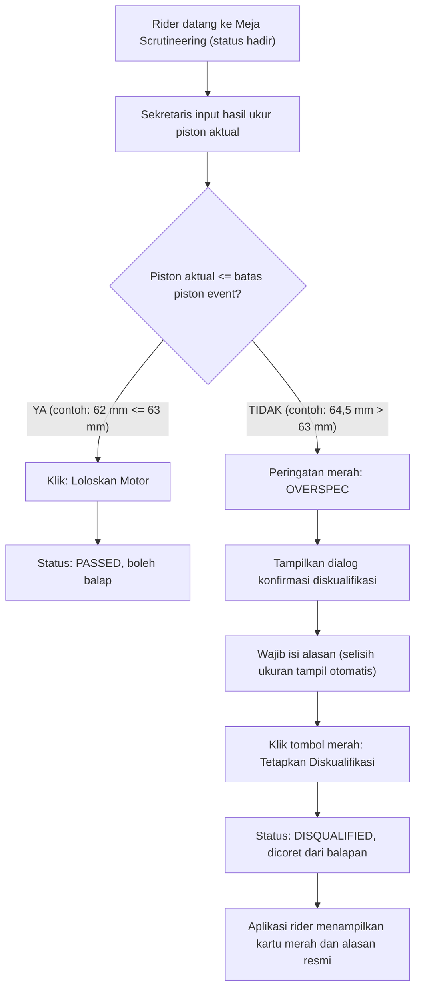
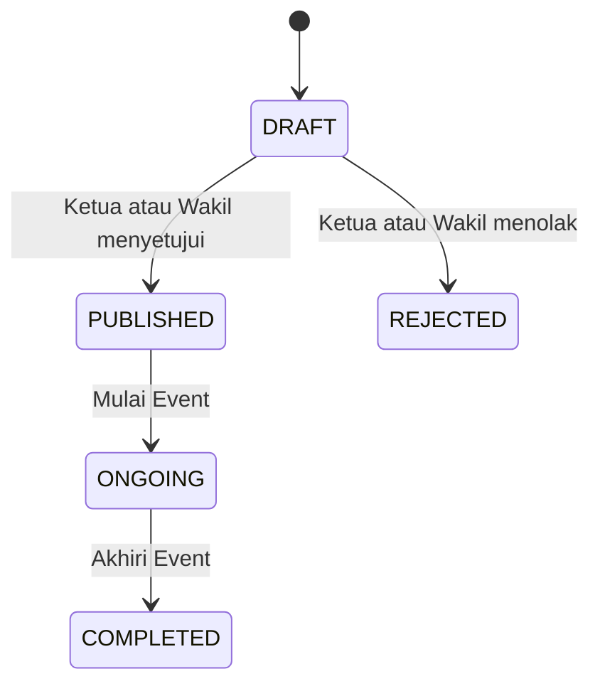
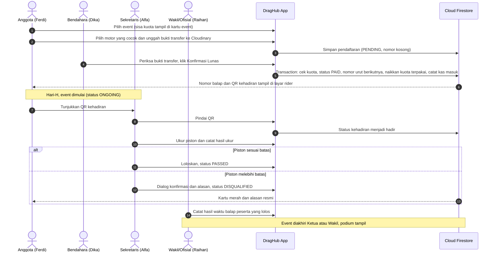

# Product Requirements Document (PRD)
## DragHub: Sistem Informasi Komunitas & Manajemen Balap Drag Resmi
**Versi:** 1.3.1 (Kuota Peserta, Nomor Urut Lunas, Scrutineering Sebelum Balap, Braket & Podium; Revisi Konsistensi dengan ERD dan GitFlow)  
**Tanggal:** 10 November 2026  
**Status:** Revisi untuk review tim  
**Platform:** Flutter Mobile (Android & iOS) + Google Firebase (Auth & Cloud Firestore, plan Spark) + Cloudinary (penyimpanan gambar)  
**Dokumen Terkait:** [ERD_DragHub.md](ERD_DragHub.md) | [Pembagian_Tugas_GitFlow.md](Pembagian_Tugas_GitFlow.md)

---

## 0. Ringkasan Perubahan dari v1.2

* **Satu event = satu kelas.** Kelas ditentukan oleh tipe kendaraan, batas piston, dan braket waktu yang melekat pada event. Rider hanya bisa mendaftar dengan motor yang cocok.
* **Kuota peserta** per event, dengan sisa kuota tampil di kartu event untuk semua peran.
* **Nomor balap urut lunas** (`#001` dst, tanpa nomor sakral), terbit saat Bendahara memverifikasi pembayaran. Peserta yang tidak hadir dicoret, nomor lain tidak bergeser.
* **Status event `ONGOING`** dengan tombol "Mulai Event" dan "Akhiri Event" oleh Ketua atau Wakil.
* **Verifikasi kehadiran memakai QR** di hari-H.
* **Scrutineering dilakukan sebelum balap** (bukan sesudahnya), tanpa toleransi ukur. Diskualifikasi wajib beserta alasan. Rider yang keberatan dapat meminta **scrut ulang** oleh Ketua atau Wakil.
* **Leaderboard realtime diganti podium juara 1 sampai 3** yang tampil setelah event selesai. Setiap peserta hanya balap satu kali. Hasil yang lebih cepat dari braket dinyatakan gugur (`BREAKOUT`).
* **Kebijakan:** biaya pendaftaran tidak dikembalikan jika peserta didiskualifikasi. Role pengurus diubah manual lewat Firebase Console.
* **Perbaikan konsistensi:** status scrut memakai `PASSED`, wording "konfirmasi ganda/bertingkat" disesuaikan dengan dialog yang sebenarnya, telemetri menjadi tugas Wakil (Ofisial) sesuai tabel peran, dan label diagram Mermaid dibungkus tanda kutip.

* **Revisi v1.3.1 (sinkronisasi dengan ERD v1.3.1 dan GitFlow v1.3):**
  * Alur penolakan bukti bayar ditambahkan (alasan wajib, rider unggah ulang). Verifikasi dan penolakan hanya berlaku saat event `PUBLISHED`.
  * Ditambahkan aksi **Tutup Verifikasi Kehadiran** yang mencoret peserta lunas yang belum hadir (sebelumnya pemicunya tidak didefinisikan).
  * Status hasil balap `JUMP_START` dan `DNF` ditambahkan (ditandai Ofisial, tidak ikut peringkat).
  * Hak Wakil untuk menyetujui/menolak event dicantumkan di tabel peran.
  * Flowchart dialog DQ diselaraskan: hanya alasan yang wajib diisi, selisih ukuran tampil otomatis.

---

## 1. Latar Belakang & Tujuan Produk

### 1.1 Problem Statement
Komunitas balap motor drag mengalami kendala operasional yang masih konvensional (tersebar di WhatsApp dan catatan fisik):
1. **Regulasi Kelas Balap & Scrutineering:** Kelas ditentukan oleh **Tipe Transmisi (Matic / Kopling)**, **Ukuran Diameter Piston (mm)**, dan **Braket waktu**. Pengukuran fisik (*scrutineering*) rawan manipulasi atau *human error* jika tidak tercatat dengan bukti kuat.
2. **Pencatatan Keuangan & Verifikasi Pembayaran:** Pengecekan bukti transfer pendaftaran berada di bawah wewenang resmi **Bendahara**.
3. **Penomoran Balap & Kuota yang Tertib:** Nomor balap diterbitkan berurutan hanya setelah pembayaran lunas, dan jumlah peserta dibatasi kuota event.
4. **Prosedur Diskualifikasi Resmi:** Diskualifikasi karena overspec piston membutuhkan dialog konfirmasi dan alasan tertulis wajib agar tidak terjadi salah klik dan dapat menjadi dasar laporan.
5. **Permintaan Dosen Praktikum:** Sistem harus merefleksikan hierarki resmi komunitas: **Ketua**, **Wakil Ketua**, **Sekretaris**, **Bendahara**, dan **Anggota (Pembalap)**.

### 1.2 Tujuan Produk (Goals)
* **Standardisasi Regulasi Piston:** Piston terukur $\le$ batas kelas event dinyatakan **Lolos Scrutineering**, piston $>$ batas (tanpa toleransi) dinyatakan **Diskualifikasi (DQ)**.
* **Protokol Diskualifikasi (Anti-Misclick):** Petugas wajib memasukkan ukuran aktual dan alasan, lalu mengonfirmasi lewat dialog sebelum diskualifikasi ditetapkan. Rider yang keberatan dapat meminta scrut ulang.
* **Akuntabilitas Finansial & Nomor Balap Urut Lunas:** Verifikasi bukti transfer oleh Bendahara menerbitkan nomor balap berurutan dan menambah kuota terpakai dalam satu transaksi, serta mencatat kas masuk otomatis.
* **Manajemen Kuota & Kehadiran:** Sisa kuota tampil di kartu event; kehadiran hari-H diverifikasi lewat QR.
* **Manajemen Profil Kendaraan:** Pendataan motor mencakup Merk, Nama Kendaraan, Tipe (Matic/Kopling), dan Diameter Piston (mm).
* **Pencatatan Hasil Balap & Podium:** Hasil waktu balap dicatat per peserta, dan podium juara 1 sampai 3 tampil setelah event selesai.

---

## 2. Struktur Organisasi & Pembagian Kewenangan

| Peran (Role) | Personel Tim | Tanggung Jawab dalam Sistem |
| :--- | :--- | :--- |
| **Ketua (President)** | **Rafli** *(Project Lead)* | • Pengawasan menyeluruh aktivitas komunitas • Menyetujui atau menolak draft event • **Memulai dan mengakhiri event** (bersama Wakil) • **Melakukan scrut ulang** atas keberatan rider (bersama Wakil) • Memantau laporan kas dan log diskualifikasi |
| **Wakil Ketua** | **Raihan** | • Membantu tugas eksekutif Ketua dan menggantikan jika Ketua berhalangan • **Ofisial pencatat hasil waktu balap** • Menyetujui atau menolak draft event (bersama Ketua) • Memulai/mengakhiri event dan scrut ulang |
| **Sekretaris** | **Alfa** | • Menyusun draft event: kelas (tipe, batas piston, braket), biaya, kuota, poster • **Petugas utama meja scrutineering:** input hasil ukur piston dan, bila overspec, menetapkan diskualifikasi beserta alasan • Memverifikasi kehadiran peserta lewat pemindaian QR dan menutup verifikasi kehadiran *(usulan, lihat bagian 7)* |
| **Bendahara** | **Dika** | • Memeriksa dan memverifikasi bukti transfer pendaftaran • Mengesahkan pembayaran menjadi **LUNAS (PAID)** yang menerbitkan nomor balap • Menolak bukti transfer yang tidak valid dengan alasan tertulis • Mencatat kas masuk/keluar dan transparansi saldo *(Bendahara tidak mengurusi teknis mesin)* |
| **Anggota (Pembalap/Rider)** | **Ferdi** | • Mendaftarkan profil motor • Mendaftar event dengan motor yang cocok dan mengunggah bukti transfer • Menerima nomor balap dan QR kehadiran setelah lunas • Menerima status scrut (Lolos / Diskualifikasi beserta alasan) dan melihat podium |

---

## 3. Regulasi Kelas, Braket & Scrutineering

### 3.1 Aturan Kelas Event dan Kecocokan Motor
Setiap event hanya memiliki **satu kelas**, dibentuk dari tiga field di event:
* **Tipe Kendaraan:** `Matic` atau `Kopling`.
* **Batas Maksimal Diameter Piston (mm):** contoh `63` (Matic) atau `66` (Kopling).
* **Braket waktu (detik):** contoh `7`.

Contoh label kelas: **Matic s.d 63 mm - Braket 7**.

Rider hanya boleh mendaftar dengan motor yang memenuhi **kedua** syarat berikut:
1. `tipe motor` = `tipe event`.
2. `piston motor` $\le$ `batas piston event` (contoh: motor piston 59 mm boleh mendaftar di event Matic 63 mm).

Motor yang tidak memenuhi syarat tidak muncul di pilihan saat mendaftar. Spesifikasi motor tidak perlu disetujui pengurus karena kebenarannya dibuktikan saat scrutineering. Satu rider hanya dapat mendaftar satu kali di satu event.

### 3.2 Ketentuan Logika Scrutineering (Inspeksi Fisik Sebelum Balap)
Scrutineering dilakukan di hari-H, **sebelum balap**, hanya untuk peserta yang sudah lunas dan sudah terverifikasi hadir.
* **Aturan Lolos:** Piston terukur **HARUS $\le$ batas piston event**.
  * *Contoh:* Vario piston terukur 62 mm di event Matic 63 $\rightarrow$ **PASSED**.
* **Aturan Diskualifikasi:** Piston terukur **$>$ batas** $\rightarrow$ **DISQUALIFIED**.
  * *Contoh:* Aerox terukur 64,5 mm di event Matic 63 $\rightarrow$ **DISQUALIFIED**.
* **Tanpa toleransi ukur:** selisih sekecil apa pun di atas batas (contoh 63,02 mm untuk batas 63 mm) tetap diskualifikasi. Pengaman satu-satunya adalah scrut ulang (3.4).

### 3.3 Protokol Dialog Konfirmasi Diskualifikasi (Anti-Misclick)

#### Spesifikasi UI Dialog Konfirmasi Diskualifikasi
1. **Header:** peringatan merah tegas (`Icons.warning_amber_rounded`) bertuliskan *"KONFIRMASI DISKUALIFIKASI PEMBALAP"*.
2. **Ringkasan data pembanding:**
   * Nama pembalap dan nomor balap, contoh `#089 • Ferdi Rider`.
   * Batas piston event: **63,0 mm**.
   * Ukuran terukur: **64,5 mm** *(overspec +1,5 mm)*.
3. **Field alasan (wajib):** contoh *"Piston terukur 66 mm, ketentuan event maksimal 63 mm"*. Alasan menjadi bahan laporan event.
4. **Tombol:** "Batal / Ukur Ulang" dan tombol merah **"Tetapkan Diskualifikasi"** (mengubah status menjadi `DISQUALIFIED` dan mencatat UID pemeriksa serta waktu).

### 3.4 Scrut Ulang (Keberatan Rider)
* Rider yang merasa salah ukur datang langsung ke Ketua atau Wakil. Aplikasi tidak memiliki fitur pengajuan keberatan.
* **Ketua atau Wakil** (bukan petugas yang mengukur pertama) mengukur ulang lewat layar scrut yang sama, selama event berstatus `ONGOING`.
* Setiap pemeriksaan dicatat di riwayat scrut dan tidak menimpa data sebelumnya. Hasil terbaru menjadi status yang berlaku.
* Jika hasil ulang lolos, rider kembali boleh balap dan nomor serta kuota tidak berubah. Jika tetap overspec, alasan wajib diisi lagi.

### 3.5 Braket dan Penentuan Juara
* Braket ditetapkan per event (contoh Braket 7), jadi semua peserta satu event berada di braket yang sama dan podiumnya tunggal.
* Setiap peserta **hanya balap satu kali**.
* Pembanding braket dan peringkat memakai **total waktu** (reaction time + waktu tempuh).
* **Gugur (BREAKOUT):** total waktu **lebih cepat** dari braket (contoh 6,9 detik di Braket 7) otomatis berstatus `BREAKOUT` dan peserta gugur dari peringkat. Petugas tidak dapat mengubahnya menjadi sah.
* Waktu **lebih lambat** dari braket (contoh 8,3 detik di Braket 7) tetap sah, hanya peringkatnya di bawah.
* **Juara 1 sampai 3** adalah tiga peserta dengan total waktu tercepat di antara hasil yang sah. Jika total waktu sama, **reaction time yang lebih kecil menang**.

---

## 4. Spesifikasi Form & Alur Bisnis Utama

### 4.1 Form Profil Motor Pembalap
Saat anggota menambahkan motor, form mengumpulkan:
1. **Merk Kendaraan:** Dropdown `Honda`, `Yamaha`, `Suzuki`, `Kawasaki`, `Vespa`.
2. **Nama Kendaraan:** Input teks (contoh `Vario 125`, `Sprint 150`, `Aerox 155`, `Mx King`, `CBR 150R`, `Ninja 150`).
3. **Tipe Kendaraan:** Dropdown `Matic` (CVT) atau `Kopling` (manual).
4. **Ukuran Diameter Piston (mm):** Input numerik (contoh `59`, `60`, `62`, `63`, `66`).

Satu anggota boleh memiliki beberapa motor.

### 4.2 Siklus Status Event

* **DRAFT:** disusun Sekretaris (judul, lokasi, tanggal, poster, kelas, braket, biaya, kuota).
* **PUBLISHED:** event tampil, pendaftaran dan verifikasi pembayaran berjalan.
* **ONGOING:** pendaftaran dan verifikasi pembayaran tertutup; verifikasi kehadiran, scrutineering, dan pencatatan hasil aktif.
* **COMPLETED:** podium tampil dan data terkunci.
* Tidak ada field batas waktu pendaftaran: pendaftaran tertutup saat event dimulai atau saat kuota penuh.

### 4.3 Alur Pendaftaran, Pembayaran, Nomor Balap, dan Hari-H

> **Siapa yang memverifikasi pembayaran?**  
> **BENDAHARA (Dika)** adalah satu-satunya ofisial yang berwenang memvalidasi bukti transfer.

**Penolakan bukti bayar:** jika bukti tidak valid, Bendahara menolak dengan mengisi alasan. Status menjadi `REJECTED`, alasan tampil di layar rider, dan rider dapat mengunggah bukti baru pada pendaftaran yang sama (status kembali `PENDING`). Verifikasi dan penolakan hanya dapat dilakukan saat event `PUBLISHED`. Pendaftaran yang masih `PENDING` atau `REJECTED` saat event dimulai tidak dapat diverifikasi lagi, tidak mendapat nomor balap, dan tidak ikut balapan (lihat bagian 7).

### 4.4 Kuota dan Nomor Balap
* Setiap event memiliki **kuota** (contoh 50). **Sisa kuota** = kuota dikurangi jumlah peserta yang sudah lunas, ditampilkan di kartu event untuk semua peran (anggota, Ketua, Wakil, Sekretaris, Bendahara).
* Kuota terhitung saat **lunas**. Jika Bendahara memverifikasi saat kuota sudah penuh, sistem menolak. Tombol "Daftar" nonaktif saat sisa kuota 0.
* **Nomor balap** berurutan berdasarkan waktu verifikasi lunas: peserta pertama yang lunas mendapat `#001`, berikutnya `#002`, dan seterusnya. Tidak ada nomor khusus atau sakral, dan tidak ada permohonan nomor.
* Peserta yang **tidak hadir** saat verifikasi kehadiran **dicoret**. Nomornya tidak dipakai ulang dan nomor lain **tidak bergeser** (contoh: `#002` tidak hadir, `#003` tetap `#003`).

### 4.5 Verifikasi Kehadiran Memakai QR
* Setelah lunas, rider melihat QR di aplikasinya. Isi QR adalah ID pendaftaran.
* Saat event `ONGOING`, petugas memindai QR. Pendaftaran yang lunas dan belum hadir menjadi **hadir**.
* Pemindaian kedua pada QR yang sama ditolak ("sudah hadir"), sehingga screenshot QR tidak dapat dipakai ulang.
* Petugas menekan tombol **Tutup Verifikasi Kehadiran** (usulan: Sekretaris; Ketua atau Wakil juga boleh). Saat itu semua peserta lunas yang masih belum hadir otomatis berstatus **dicoret** (`ABSENT`), dan pemindaian QR berikutnya ditolak.

### 4.6 Pencatatan Hasil Waktu Balap
* Hanya aktif saat event `ONGOING`, dan hanya untuk peserta yang **lunas, hadir, dan lolos scrut**.
* Ofisial (Wakil) memasukkan lintasan (Lane 01 atau Lane 02), *reaction time*, dan *elapsed time*. Total waktu dihitung otomatis. Ofisial juga dapat menandai hasil sebagai `JUMP_START` (start sebelum lampu hijau) atau `DNF` (tidak menyelesaikan lintasan). Kedua status ini tidak ikut peringkat.
* Sebelum disimpan, aplikasi menampilkan **ringkasan konfirmasi** (nomor, reaction time, elapsed time, total).
* Hasil **boleh ditimpa** selama event `ONGOING` jika ada salah input, dan **terkunci** saat event `COMPLETED`. Tidak ada riwayat koreksi.
* **Sumber waktu:** pencatatan manual oleh Ofisial, bukan sensor finish otomatis (lihat bagian 7).

### 4.7 Podium
* Podium juara 1 sampai 3 **hanya tampil setelah event berstatus `COMPLETED`**. Tidak ada klasemen realtime.
* Saat event diakhiri, sistem menghitung peringkat sesuai 3.5 dan menyimpan hasilnya sebagai podium event.

---

## 5. Matriks Hak Akses (Role-Based Access Control / RBAC)

| Fitur / Modul | Anggota (Rider) | Sekretaris | Bendahara | Ketua & Wakil |
| :--- | :---: | :---: | :---: | :---: |
| **Input Profil Motor** | ✅ Create / Edit | ❌ | ❌ | ❌ |
| **Lihat Event & Sisa Kuota** | ✅ Read | ✅ Read | ✅ Read | ✅ Read |
| **Daftar Event (motor cocok) & Upload Bukti** | ✅ Create | ❌ | ❌ | ❌ |
| **Buat / Edit Draft Event (kelas, braket, kuota, biaya, poster)** | ❌ | ✅ Create / Edit | ❌ | ✅ Full Access |
| **Approve / Tolak Event** | ❌ | ❌ | ❌ | ✅ **Full Approve** |
| **Mulai & Akhiri Event** | ❌ | ❌ | ❌ | ✅ **Full Access** |
| **Verifikasi / Tolak Bukti Transfer & Terbitkan Nomor Balap** | ❌ | ❌ | ✅ **Full Approve** | ✅ Monitoring |
| **Lihat Nomor Balap & QR Kehadiran** | ✅ (setelah lunas) | ✅ Read | ✅ Read | ✅ Read |
| **Verifikasi Kehadiran (Pindai QR) & Tutup Verifikasi Kehadiran** | ❌ | ✅ **Petugas** | ❌ | ✅ Full Access |
| **Input Ukur Scrutineering, Loloskan & Diskualifikasi** | ❌ | ✅ **Petugas Scrut** | ❌ | ✅ Full Access |
| **Scrut Ulang (Keberatan Rider)** | ❌ | ❌ | ❌ | ✅ **Full Access** |
| **Catat / Koreksi Hasil Waktu Balap (selama ONGOING)** | ❌ | ❌ | ❌ | ✅ **Wakil (Ofisial)**, Ketua Full Access |
| **Lihat Podium (setelah COMPLETED)** | ✅ Read | ✅ Read | ✅ Read | ✅ Read |
| **Catat Kas & Lihat Saldo Komunitas** | ❌ | ❌ | ✅ **Full Access** | ✅ Monitoring |
| **Lihat Log Diskualifikasi** | ✅ (miliknya) | ✅ Read | ❌ | ✅ Monitoring |

**Penetapan role:** role pengurus (`ketua`, `wakil`, `sekretaris`, `bendahara`) diubah **manual lewat Firebase Console**, tidak ada fitur kelola role di aplikasi. Akun baru selalu berperan `anggota`. Nilai role ditulis persis huruf kecil, dan perubahan role terbaca aplikasi lewat stream dokumen pengguna.

---

## 6. Kebutuhan Non-Fungsional
1. **Pencegahan Human Error:** Diskualifikasi wajib melewati dialog konfirmasi dengan alasan wajib. Pencatatan hasil waktu wajib melewati ringkasan konfirmasi.
2. **Auditabilitas Diskualifikasi:** Sistem menyimpan UID pemeriksa, waktu, ukuran terukur, alasan, dan riwayat seluruh pemeriksaan (termasuk scrut ulang).
3. **Transparansi ke Pembalap:** Status diskualifikasi tampil di halaman utama rider beserta ukuran aktual dan alasan.
4. **Konsistensi Data:** Verifikasi lunas, nomor balap, kuota terpakai, dan kas masuk dijalankan dalam **satu transaksi Firestore** agar tidak ada nomor kembar atau kuota terlewati.
5. **Keamanan Akses:** Firestore Security Rules membatasi hak tulis per peran dan per field (misalnya: client tidak boleh mengubah `role`; hanya Bendahara yang mengubah status bayar dan kuota terpakai; hanya Ketua/Wakil yang mengubah scrut pada peserta yang sudah didiskualifikasi; hasil terkunci setelah event `COMPLETED`).
6. **Penyimpanan Gambar:** Bukti transfer dan poster diunggah ke Cloudinary lewat *unsigned upload preset* (format dibatasi, tujuan folder tertentu). API secret tidak boleh ada di aplikasi.

---

## 7. Batasan, Asumsi & Kebijakan
1. **Tidak ada sensor timing:** DragHub adalah proyek tugas kuliah. Waktu balap dicatat manual oleh Ofisial (stopwatch atau simulasi), bukan dari sensor finish. Nama fitur "telemetri" dipakai untuk pencatatan hasil waktu.
2. **Tanpa refund:** biaya pendaftaran tidak dikembalikan jika peserta didiskualifikasi. Uang tetap tercatat sebagai kas masuk sejak verifikasi lunas. *(Peserta yang tidak hadir diasumsikan mengikuti kebijakan yang sama.)*
3. **Tanpa toleransi ukur** pada scrutineering. Pengaman: scrut ulang.
4. **Plan Firebase Spark:** tanpa Cloud Functions dan tanpa Firebase Storage. Konsistensi data dijaga lewat transaksi di aplikasi.
5. **Batasan Cloudinary:** gambar tidak dapat dihapus dari aplikasi (mengganti bukti bayar berarti URL baru), dan URL bersifat publik bagi yang memiliki tautannya.
6. **Petugas pemindai QR** diasumsikan Sekretaris, begitu pula yang menekan tombol Tutup Verifikasi Kehadiran (Ketua atau Wakil juga boleh). Perlu dikonfirmasi tim.
7. **Reaction time** sebagai penentu seri berupa angka yang dimasukkan manual.
8. **Satu event satu kelas** dan **satu rider satu pendaftaran** per event. Jika kelak dibutuhkan banyak kelas per event, struktur data perlu diperluas.
9. **Pendaftaran belum lunas saat event dimulai:** pendaftaran berstatus `PENDING` atau `REJECTED` saat event berubah ke `ONGOING` tidak dapat diverifikasi lagi, tidak mendapat nomor balap, dan tidak ikut balapan. Tidak ada uang yang masuk, sehingga tidak ada yang perlu dikembalikan.
