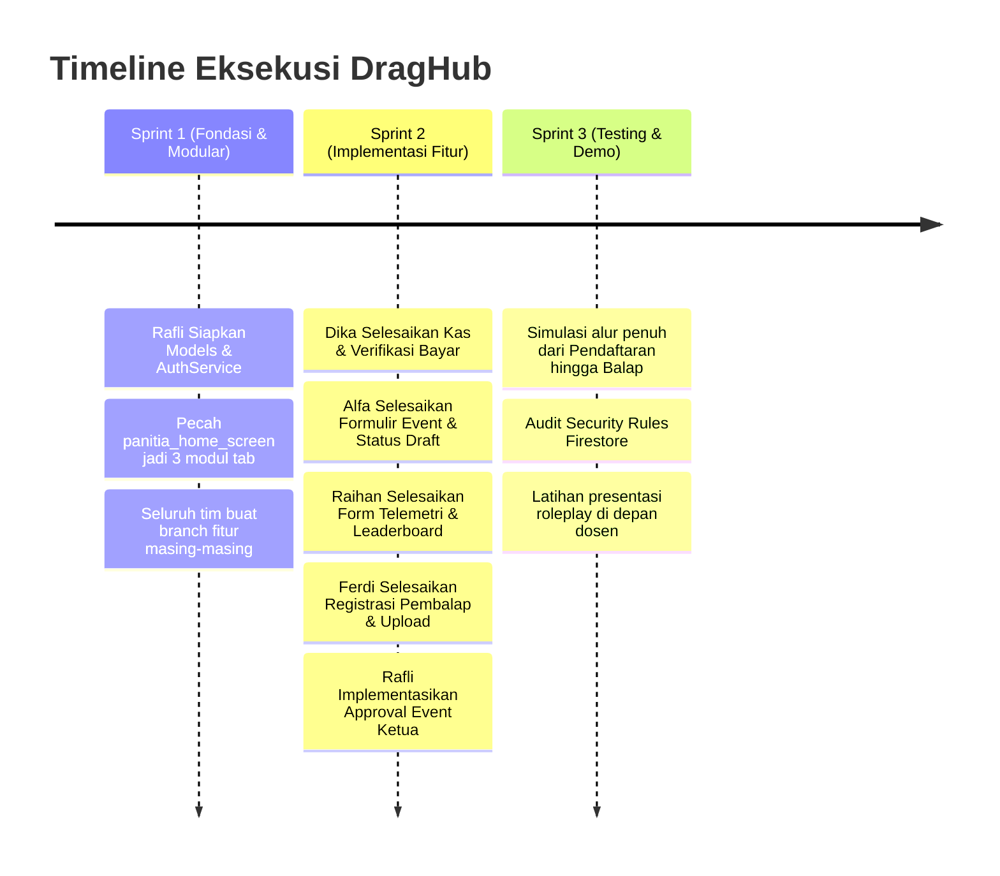

# Panduan Pembagian Kerja & Standar Git Pull Request
## DragHub Mobile Team (Kolaborasi 5 Developer)
**Anggota Tim:** Rafli (Lead), Dika, Alfa, Raihan, Ferdi  
**Dokumen Terkait:** [PRD_DragHub.md](PRD_DragHub.md) | [ERD_DragHub.md](ERD_DragHub.md)

---

## 1. Pemetaan Peran (Role Mapping: Teknis vs Komunitas)

Setiap anggota tim memegang **satu modul teknis utama** sekaligus memegang **satu jabatan organisasi resmi** untuk penilaian dosen:

| Anggota Tim | Jabatan Komunitas | Track Teknis | Modul Fitur & Tugas Utama |
| :--- | :--- | :--- | :--- |
| **Rafli** *(Lead)* | **Ketua (President)** | **Core Architecture & RBAC** | • Setup arsitektur folder (`models/`, `services/`)<br>• Logika otorisasi peran & alur approval event Ketua<br>• Gatekeeper Git (Final Review & Merge PR ke `main`) |
| **Dika** | **Bendahara** | **Finansial & Verifikasi Kas** | • Modul Kas Komunitas (`lib/services/kas_service.dart`)<br>• UI Catat Kas Masuk/Keluar & Transparansi Saldo<br>• Dialog verifikasi struk transfer pendaftaran event |
| **Alfa** | **Sekretaris** | **Event Management & Publikasi** | • Modul Event (`lib/services/event_service.dart`)<br>• Formulir input & edit agenda kejuaraan/latber<br>• Pengelolaan kuota starter & regulasi teknis |
| **Raihan** | **Wakil Ketua / Ofisial** | **Telemetri & Leaderboard** | • Modul Telemetri (`lib/services/telemetry_service.dart`)<br>• Form input sensor finish (Reaction & Elapsed Time)<br>• Tampilan klasemen realtime (`leaderboard_screen.dart`) |
| **Ferdi** | **Anggota (Pembalap)** | **Rider Experience & Paddock** | • Alur pendaftaran event oleh pembalap (upload bukti bayar)<br>• Halaman Beranda Pembalap (`home_screen.dart`)<br>• Halaman Profil & Registrasi (`register_screen.dart`) |

---

## 2. Pemetaan Kepemilikan File (File Ownership Matrix)

Untuk mencegah terjadinya *merge conflict*, setiap anggota tim hanya boleh mengedit file yang menjadi tanggung jawabnya:

```
lib/
├── models/
│   ├── user_model.dart            <-- Rafli
│   ├── kas_model.dart             <-- Dika
│   ├── event_model.dart           <-- Alfa
│   ├── race_result_model.dart     <-- Raihan
│   └── registration_model.dart    <-- Ferdi
├── services/
│   ├── auth_service.dart          <-- Rafli
│   ├── kas_service.dart           <-- Dika
│   ├── event_service.dart         <-- Alfa
│   └── telemetry_service.dart     <-- Raihan
├── screens/
│   ├── login_screen.dart          <-- Rafli
│   ├── register_screen.dart       <-- Ferdi
│   ├── home_screen.dart           <-- Ferdi
│   ├── leaderboard_screen.dart    <-- Raihan
│   └── panitia/
│       ├── tab_kas_view.dart      <-- Dika (Refactor dari panitia_home_screen)
│       ├── tab_event_view.dart    <-- Alfa (Refactor dari panitia_home_screen)
│       └── tab_telemetri.dart     <-- Raihan (Refactor dari panitia_home_screen)
└── widgets/                       <-- Komponen bersama (Ferdi & Raihan)
```

---

## 3. Protokol Git & Pull Request (Aturan 5 Developer)

### 3.1 Tiga Aturan Emas (Golden Rules)
1. **Dilarang Push Langsung ke `main`:** Branch `main` hanya diisi melalui Pull Request (PR) yang telah disetujui.
2. **Satu Fitur = Satu Branch:** Nama branch wajib diawali dengan kategori:
   * `feat/nama-fitur-nama` (contoh: `feat/kas-service-dika`, `feat/event-form-alfa`)
   * `fix/nama-bug-nama` (contoh: `fix/telemetry-calc-raihan`)
   * `refactor/nama-modul-nama` (contoh: `refactor/split-tabs-rafli`)
3. **Peer Review Wajib:** Setiap PR harus di-review oleh rekan pasangan sebelum disetujui oleh Rafli (Lead).

---

### 3.2 Pasangan Reviewer Silang (Peer Review Partner)
* **Dika (Kas)** $\leftrightarrow$ **Ferdi (Pendaftaran Pembalap)** *(Karena alur bukti bayar Ferdi diverifikasi oleh Dika)*.
* **Alfa (Event)** $\leftrightarrow$ **Raihan (Telemetri Balap)** *(Karena event yang dibuat Alfa menerima hasil balap dari Raihan)*.
* **Rafli (Lead)** melakukan *Final Check & Merge* ke branch `main`.

---

### 3.3 Alur Kerja Harian Terminal Git (Step-by-Step)

#### Langkah 1: Tarik Update Terbaru dari `main`
Sebelum mulai ngoding di pagi hari, selalu pastikan kode lokal kalian sinkron:
```bash
git checkout main
git pull origin main
```

#### Langkah 2: Buat Branch Baru untuk Tugas Kalian
```bash
git checkout -b feat/kas-service-dika
```

#### Langkah 3: Kerjakan Kode & Commit Berkala
Gunakan pesan commit yang jelas dan sopan:
```bash
git add lib/services/kas_service.dart
git commit -m "feat(kas): tambah fungsi pencatatan mutasi kas masuk dan keluar"
```

#### Langkah 4: Push Branch ke GitHub
```bash
git push -u origin feat/kas-service-dika
```

#### Langkah 5: Buka Pull Request (PR) di Browser GitHub
1. Masuk ke halaman repo GitHub.
2. Klik tombol hijau **"Compare & pull request"**.
3. Beri judul jelas: `feat(kas): Implementasi KasService untuk Bendahara`.
4. Pilih reviewer rekan kerja kalian.
5. Setelah rekan me-review (*Approve*) dan Rafli menyetujui, klik **"Merge Pull Request"**.

#### Langkah 6: Hapus Branch & Update `main` Lokal
```bash
git checkout main
git pull origin main
git branch -d feat/kas-service-dika
```

---

## 4. Roadmap Pengerjaan 3 Sprint (Target Selesai Praktikum)



